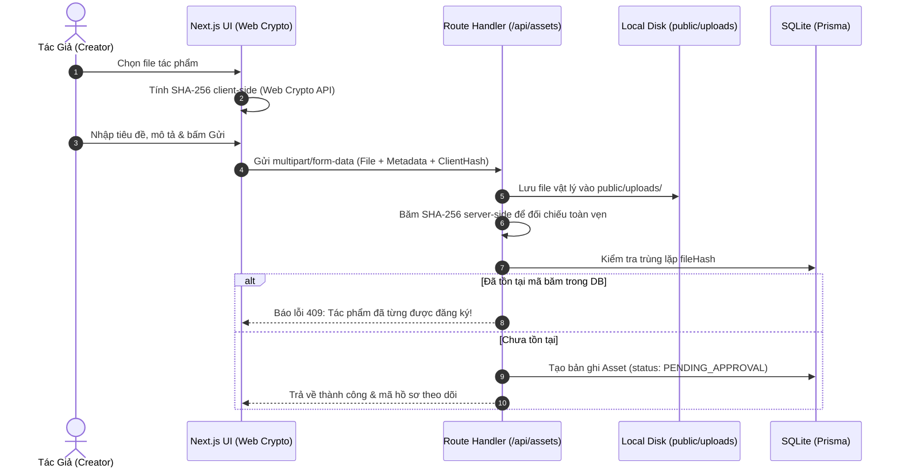
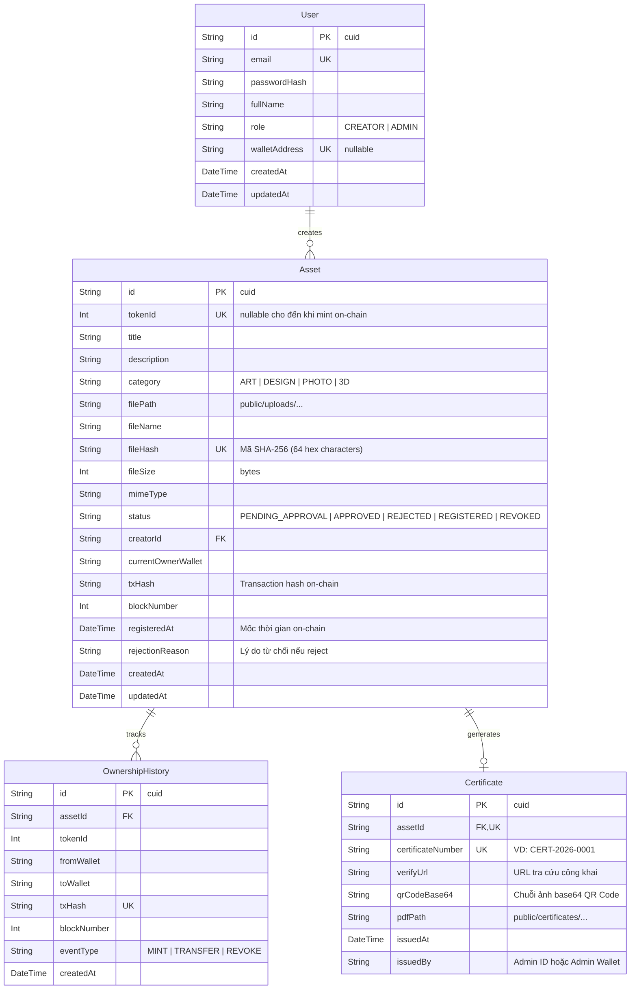

# **BỘ GIÁO DỤC VÀ ĐÀO TẠO — TRƯỜNG ĐẠI HỌC CÔNG NGHỆ**
**KHOA CÔNG NGHỆ THÔNG TIN — BỘ MÔN MẠNG VÀ HỆ THỐNG PHÂN TÁN**

---

# **KẾ HOẠCH PHÁT TRIỂN DỰ ÁN 14 NGÀY (BẢN HỢP NHẤT TOÀN DIỆN)**

## **HỆ THỐNG ĐĂNG KÝ VÀ QUẢN LÝ QUYỀN SỞ HỮU TÀI SẢN SỐ TRÊN NỀN TẢNG BLOCKCHAIN (ASSETCHAIN)**

> **Tài liệu Kế hoạch Tổng thể Duy nhất — Đặc tả Kỹ thuật, Kiến trúc Local-First, Phân công 50/50 theo Lát cắt Dọc (Vertical Slicing), Quy trình Độc lập trên 2 máy và Kịch bản Nghiệm thu Điểm Tối đa (10/10)**

| Thông Tin Dự Án | Chi Tiết Thực Hiện |
|:---|:---|
| **Môn học / Học phần:** | Công nghệ Blockchain và Ứng dụng |
| **Chuyên ngành:** | Kỹ thuật Phần mềm / Mạng máy tính & An toàn thông tin |
| **Nhóm sinh viên thực hiện:** | Nhóm 02 thành viên: **Thành viên A** & **Thành viên B** |
| **Mô hình phân công:** | **Vertical Slicing:**<br>• Thành viên A: Nền tảng & Đăng ký Tài sản (Fullstack + Web3 Core)<br>• Thành viên B: Thẩm định Xét duyệt & Bộ máy Chứng nhận (Fullstack + Web3 Verify) |
| **Kiến trúc vận hành:** | **Local-First Fullstack:** Next.js 14/15 App Router + SQLite Prisma + Hardhat Local EVM |
| **Hội đồng chấm thi:** | Giảng viên Bộ môn Công nghệ Phần mềm & Mạng máy tính |
| **Thời gian thực hiện:** | 14 ngày (2 tuần) — Vận hành hoàn toàn Cục bộ (Zero Docker, Zero Cloud Dependency) |

---

## 📌 MỤC LỤC TỔNG HỢP

1. [Tổng Quan Dự Án và Phạm Vi Chức Năng](#1-tổng-quan-dự-án-và-phạm-vi-chức-năng)
2. [Bảng Công Nghệ Cuối Cùng và Lý Do Lựa Chọn](#2-bảng-công-nghệ-cuối-cùng-và-lý-do-lựa-chọn)
3. [Kiến Trúc Hệ Thống và 6 Luồng Dữ Liệu Cốt Lõi](#3-kiến-trúc-hệ-thống-và-6-luồng-dữ-liệu-cốt-lõi)
4. [Cấu Trúc Thư Mục Dự Án Chuẩn (Single Next.js Root)](#4-cấu-trúc-thư-mục-dự-án-chuẩn-single-nextjs-root)
5. [Thiết Kế Database (SQLite) và Smart Contract Chuyên Sâu](#5-thiết-kế-database-sqlite-và-smart-contract-chuyên-sâu)
6. [Phân Chia Công Việc Hai Thành Viên (Vertical Slicing 50/50)](#6-phân-chia-công-việc-hai-thành-viên-vertical-slicing-5050)
7. [Quy Trình Làm Việc Độc Lập Trên Hai Máy Local](#7-quy-trình-làm-việc-độc-lập-trên-hai-máy-local)
8. [Quy Trình Git và Tích Hợp Code (Branching & Merge Checkpoints)](#8-quy-trình-git-và-tích-hợp-code-branching--merge-checkpoints)
9. [Kế Hoạch Triển Khai Chi Tiết 14 Ngày (Day-by-Day Agile)](#9-kế-hoạch-triển-khai-chi-tiết-14-ngày-day-by-day-agile)
10. [Checklist Kiểm Thử, 6 Yếu Tố WOW và Kịch Bản Demo Điểm 10/10](#10-checklist-kiểm-thử-6-yếu-tố-wow-và-kịch-bản-demo-điểm-1010)

---

# 1. TỔNG QUAN DỰ ÁN VÀ PHẠM VI CHỨC NĂNG

### 1.1. Bối cảnh và Bài toán giải quyết
Trong thời đại bùng nổ của nội dung số, các tác phẩm nghệ thuật kỹ thuật số, đồ họa vector, bản thiết kế 2D/3D, và ảnh chụp nghệ thuật đối mặt với nguy cơ sao chép, đánh cắp quyền tác giả và mạo danh nguồn gốc. Các cơ chế đăng ký bản quyền truyền thống mất nhiều tuần lễ, tốn kém chi phí hành chính và thiếu một công cụ công nghệ độc lập cho phép bất kỳ ai cũng có thể xác minh tức thì.

**AssetChain** giải quyết bài toán: *Làm thế nào để nhà sáng tạo chứng minh một cách không thể chối cãi rằng tác phẩm của họ đã tồn tại ở một thời điểm chính xác trong quá khứ và thuộc quyền sở hữu của họ, đồng thời cho phép công chúng kiểm tra tính nguyên bản của tác phẩm chỉ trong 1 giây mà không phụ thuộc vào cơ quan trung gian?*

### 1.2. Tuyên bố pháp lý & Ranh giới kỹ thuật bắt buộc
> [!IMPORTANT]
> **LEGAL DISCLAIMER & TECHNICAL BOUNDARIES**
> 1. **Bản chất kỹ thuật:** Hệ thống cung cấp **Bằng chứng kỹ thuật về sự tồn tại và tính toàn vẹn (Technical Proof of Existence & Immutability)** dựa trên mật mã học (SHA-256) và sổ cái phân tán EVM. Hệ thống chứng minh tệp tin đã tồn tại ở trạng thái chính xác đó tại thời điểm giao dịch được đóng block.
> 2. **Ranh giới pháp lý:** Đây là dự án học thuật nghiên cứu công nghệ. Hệ thống **không** tuyên bố cấp quyền sở hữu trí tuệ pháp lý thay thế cơ quan nhà nước có thẩm quyền (như Cục Bản quyền Tác giả).
> 3. **Chứng nhận điện tử mô phỏng (Simulated E-Certificate):** Đóng vai trò trực quan hóa bằng chứng on-chain, tích hợp mã QR động trỏ tới cổng tra cứu công khai và chữ ký số của hệ thống.
> 4. **An toàn bảo mật:** Tuyệt đối **không** lưu tệp nhị phân dung lượng lớn, mật khẩu tài khoản hay khóa riêng tư (Private Key) on-chain. Blockchain chỉ lưu các mẩu dữ liệu nhỏ bất biến (`tokenId`, `bytes32 contentHash`, `creator`, `owner`, `timestamp`, `tokenURI`).

### 1.3. Ranh giới phạm vi hệ thống (In-Scope vs. Out-of-Scope)
| Hạng mục Bao gồm (In-Scope) | Hạng mục Loại trừ (Out-of-Scope) |
|:---|:---|
| 1. Đăng ký tài khoản người dùng (Creator & Admin), liên kết địa chỉ ví MetaMask. | 1. Tích hợp cổng thanh toán tiền pháp định (Fiat Payment Gateway). |
| 2. Đăng ký tài sản: tải tệp lên, tự động băm **SHA-256 client-side** bằng Web Crypto API. | 2. Giải quyết tranh chấp bản quyền pháp lý ngoài đời thực. |
| 3. Quy trình thẩm định hồ sơ của Quản trị viên (Phê duyệt / Từ chối kèm lý do). | 3. Phân tích nhận diện vi phạm bản quyền bằng AI/Machine Learning phức tạp. |
| 4. Khắc dấu quyền sở hữu lên Smart Contract ERC-721 trên mạng Hardhat Local EVM. | 4. Lưu toàn bộ tệp nhị phân nhiều megabytes trực tiếp vào blockchain storage. |
| 5. Phát hành Chứng nhận điện tử mô phỏng (PDF chất lượng cao + mã QR động). | 5. Phát hành token quản trị (DAO Token) hoặc cơ chế tài chính phi tập trung (DeFi). |
| 6. Cổng xác minh độc lập công khai: **Kéo thả tệp xác minh 1-Click tức thì** đối chiếu với Smart Contract. | 6. Cấu hình triển khai hạ tầng đám mây phân tán hoặc Docker Swarm/Kubernetes. |
| 7. Chuyển nhượng quyền sở hữu tài sản on-chain và lưu vết lịch sử nguồn gốc (Provenance Timeline). |  |

---

# 2. BẢNG CÔNG NGHỆ CUỐI CÙNG VÀ LÝ DO LỰA CHỌN

Nhằm đảm bảo nhóm 2 người hoàn thành xuất sắc đồ án trong **14 ngày**, toàn bộ Tech Stack đã được tối ưu hóa theo triết lý **Local-First & Minimal Overhead**: Loại bỏ NestJS riêng biệt, loại bỏ PostgreSQL & Docker container cồng kềnh, loại bỏ sự phụ thuộc IPFS bên thứ ba trong giai đoạn dev.

| Tầng Kiến Trúc | Công Nghệ Lựa Chọn | Phiên Bản | Lý Do Kỹ Thuật Lựa Chọn (Tối ưu cho nhóm 2 người trong 14 ngày) | Đánh Đổi & Giải Pháp Khắc Phục |
|:---|:---|:---|:---|:---|
| **Frontend Framework** | **Next.js (App Router)** | v14/v15 + TypeScript | Framework hiện đại, hỗ trợ SSR/CSR linh hoạt, routing theo thư mục trực quan, chuẩn công nghiệp Web3. | Cần phân định ranh giới `use client` cho các module trình duyệt (MetaMask, Web Crypto, QR Canvas). |
| **Styling** | **Tailwind CSS** | v3.4 | Dựng giao diện Web3 Dark/Light sang trọng cực nhanh, không mất thời gian viết CSS thủ công, responsive hoàn hảo. | Sử dụng các component thiết kế sẵn, màu sắc HSL phối chuẩn Web3. |
| **Backend Architecture** | **Next.js Route Handlers (`/api/*`)** | Native Node.js Runtime | **Thay thế NestJS.** Toàn bộ API nằm chung trong dự án Next.js, khởi động bằng 1 lệnh `npm run dev`, triệt tiêu hoàn toàn lỗi CORS giữa client-server và giảm 50% thời gian cấu hình boilerplate. | Cần tổ chức code trong `src/app/api/` ngăn nắp theo cấu trúc module rõ ràng. |
| **Database & ORM** | **SQLite + Prisma ORM** | Prisma v5.x | **Thay thế PostgreSQL & Docker.** Cơ sở dữ liệu là 1 file duy nhất (`prisma/dev.db`), chạy trực tiếp bằng Node.js, không chiếm dụng cổng 5432, không cần cài đặt database engine, dễ dàng backup/reset khi demo. | SQLite phù hợp cho môi trường local/demo; có thể chuyển đổi sang PostgreSQL sau này chỉ bằng cách đổi 1 dòng trong `schema.prisma`. |
| **Smart Contract** | **Solidity + OpenZeppelin** | Solidity `^0.8.24`, OZ v5.x | Tiêu chuẩn bảo mật toàn cầu cho EVM (`ERC721URIStorage`, `Ownable`, `Pausable`). Phiên bản 0.8.24 tích hợp sẵn kiểm tra tràn số học. | Cần hiểu rõ chuẩn ERC-721 và cấu trúc dữ liệu mapping on-chain. |
| **Blockchain Network** | **Hardhat Local EVM Node** | Hardhat v2.22 (Chain ID 31337) | Mạng giả lập EVM cục bộ chạy tại `http://127.0.0.1:8545`, thời gian đào block tức thì (0s), cung cấp 20 ví test có 10,000 ETH, hiển thị console.log trong Solidity. | Mạng chạy local trên RAM; khi khởi động lại cần deploy lại contract (được tự động hóa bằng script 1-lệnh). |
| **Blockchain Interaction** | **Ethers.js v6** | v6.13 | Thư viện Web3 chuẩn mực, hỗ trợ tương tác contract, đọc event, chuyển đổi hex sang `bytes32`. | Ethers v6 dùng BigInt nguyên bản thay vì BigNumber của v5; cần chuẩn hóa helper ép kiểu. |
| **Ví Web3** | **MetaMask Browser Extension** | Chrome Extension | Ví phi tập trung phổ biến nhất, dễ dàng kết nối mạng local RPC `http://127.0.0.1:8545`. | Khi reset node cần reset nonce ví trong MetaMask (được hướng dẫn chi tiết trong tài liệu). |
| **Lưu Trữ File** | **Local File Storage (`public/uploads`)** | File System cục bộ | Lưu trữ trực tiếp file gốc và file chứng nhận vào thư mục tĩnh của Next.js, hiển thị ảnh ngay lập tức, hoàn toàn không phụ thuộc kết nối Internet hay quota của Pinata/IPFS. | Trong môi trường production cần chuyển sang IPFS/S3; tài liệu có sẵn hướng dẫn mở rộng. |
| **Vân Tay Số (Integrity)** | **Web Crypto API (SHA-256)** | W3C Standard Native API | Băm file trực tiếp trên trình duyệt bằng `window.crypto.subtle.digest("SHA-256", buffer)`, tốc độ < 0.2s, bảo vệ quyền riêng tư tuyệt đối (Zero file leak trước khi nộp). | Cần đảm bảo chuyển đổi chuỗi Hex 64 ký tự sang `bytes32` (`0x...`) chuẩn xác cho Solidity. |
| **Bộ Sinh Chứng Nhận** | **jsPDF + qrcode** | jsPDF v2.5, qrcode v1.5 | Xuất file PDF chứng nhận số đồ họa trang trọng, chèn watermark chống làm giả, tự động sinh mã QR chứa URL tra cứu thực tế. | Thiết kế layout PDF với tọa độ hình học chuẩn A4 Landscape. |

### So sánh chuyên sâu: SHA-256 (Client/Web2) vs. Keccak-256 (EVM/Web3)
Để đạt điểm tối đa khi vấn đáp với hội đồng:
- **SHA-256:** Được sử dụng để băm nội dung nhị phân của tệp tin tại Client (trình duyệt). Tạo ra chuỗi băm 32 bytes (256 bits) duy nhất đại diện cho file ảnh/tài liệu. SHA-256 là tiêu chuẩn công nghiệp toàn cầu cho nhận dạng tệp (tương thích Git, IPFS).
- **Keccak-256:** Là hàm băm nguyên bản của máy ảo Ethereum (opcode `SHA3`). Được sử dụng bên trong Smart Contract để tạo mã định danh duy nhất cho chứng nhận: `keccak256(abi.encodePacked(tokenId, contentHash, block.timestamp))`. Keccak-256 tiêu tốn cực ít Gas on-chain (30 gas + 6 gas/word), tiết kiệm gấp đôi so với việc gọi precompile SHA-256 on-chain.

---

# 3. KIẾN TRÚC HỆ THỐNG VÀ 6 LUỒNG DỮ LIỆU CỐT LÕI

### 3.1. Sơ đồ kiến trúc tổng thể 3 tầng (Local-First Architecture)

```mermaid
flowchart TB
    subgraph ClientTier ["1. CLIENT TIER (Trình duyệt Người dùng)"]
        User["Creator / Nhà Sáng Tạo"]
        AdminUser["Admin / Người Xét Duyệt"]
        GuestUser["Khách Vãng Lai / Công Chúng"]
        MetaMask["Ví MetaMask (EVM Chain ID: 31337)"]
        WebCrypto["Web Crypto API (SHA-256 Client-side)"]
        NextUI["Giao diện Next.js App Router (Tailwind CSS)"]
    end

    subgraph AppTier ["2. APPLICATION & STORAGE TIER (Next.js Server - Port 3000)"]
        RouteHandlers["Next.js Route Handlers (/api/auth, /api/assets, /api/admin, /api/verify)"]
        PrismaClient["Prisma ORM Engine"]
        CertEngine["E-Certificate PDF & QR Generator (jsPDF + qrcode)"]
        SQLiteDB[("SQLite Database\n(prisma/dev.db)")]
        LocalDisk[("Local Storage\n(public/uploads & public/certificates)")]
    end

    subgraph BlockchainTier ["3. BLOCKCHAIN TIER (Hardhat Local Node - Port 8545)"]
        HardhatNode["Hardhat Local EVM Node (JSON-RPC)"]
        Contract["AssetRegistry.sol\n(ERC-721 + Proof of Existence + Anti-Duplicate)"]
    end

    User -->|Tương tác UI & Kéo thả file| NextUI
    AdminUser -->|Thẩm định hồ sơ| NextUI
    GuestUser -->|Kéo thả file xác minh 1-Click| NextUI
    NextUI -->|Băm nhị phân tại Client| WebCrypto
    NextUI -->|Ký giao dịch mint/transfer| MetaMask
    MetaMask -->|Gửi Signed Tx qua RPC:8545| HardhatNode

    NextUI -->|REST API Requests| RouteHandlers
    RouteHandlers --> PrismaClient
    PrismaClient --> SQLiteDB
    RouteHandlers -->|Lưu file gốc & chứng nhận| LocalDisk
    RouteHandlers --> CertEngine
    CertEngine -->|Ghi file PDF| LocalDisk

    RouteHandlers -.->|Đối chiếu Tx Receipt & Logs qua JsonRpcProvider| HardhatNode
    HardhatNode --> Contract
    NextUI -.->|Đọc trực tiếp view function getAssetByHash (0 Gas)| HardhatNode
```

### 3.2. Bảng phân định 3 tầng lưu trữ dữ liệu
| Tiêu chí | Lưu trữ On-Chain (Smart Contract) | Lưu trữ Off-Chain (SQLite Database) | Lưu trữ File Cục bộ (`public/`) |
|:---|:---|:---|:---|
| **Công nghệ** | Solidity `^0.8.24` trên Hardhat EVM | SQLite file (`dev.db`) qua Prisma ORM | File System của máy tính |
| **Dữ liệu lưu trữ** | • `tokenId` (uint256)<br>• `contentHash` (bytes32 SHA-256)<br>• Địa chỉ ví tác giả (`creator`)<br>• Địa chỉ ví sở hữu (`owner`)<br>• Mốc thời gian on-chain (`registeredAt`)<br>• Cờ thu hồi `isRevoked` & lý do | • Tài khoản người dùng, email, mật khẩu băm<br>• Tiêu đề, mô tả, danh mục tác phẩm<br>• Dung lượng file, định dạng MIME<br>• Trạng thái duyệt (`PENDING_APPROVAL`, `APPROVED`, ...)<br>• Số hiệu chứng nhận (`certificateNumber`)<br>• Lịch sử chuyển quyền (`OwnershipHistory`) | • Tệp ảnh/thiết kế gốc của tác giả (`public/uploads/...`)<br>• Tệp PDF chứng nhận điện tử xuất tự động (`public/certificates/...`) |
| **Đặc tính kỹ thuật** | Bất biến (Immutable), công khai minh bạch, không thể làm giả, chống chối bỏ. | Truy vấn siêu tốc, hỗ trợ phân trang, lọc theo trạng thái, lưu dữ liệu nhạy cảm. | Dung lượng lớn (vài chục MB), phục vụ hiển thị trực tiếp trên giao diện web. |

### 3.3. Chi tiết 6 luồng dữ liệu cốt lõi

#### Luồng 1: Người dùng đăng ký tài sản (Asset Registration Flow)
1. Người dùng chọn tệp ảnh/tác phẩm trên form đăng ký (`/creator/register`).
2. Trình duyệt gọi **Web Crypto API** tính ngay mã băm `SHA-256` của tệp, hiển thị chuỗi Hex 64 ký tự trên màn hình cho người dùng kiểm chứng.
3. Người dùng điền thông tin mô tả, chọn danh mục và nhấn nút "Gửi đăng ký".
4. Dữ liệu (file nhị phân + metadata + clientHash) được gửi qua `multipart/form-data` lên API `/api/assets`.
5. Backend Route Handler:
   - Lưu file vào `public/uploads/`.
   - Tính lại mã băm server-side đối chiếu với `clientHash` (chống sửa file trên đường truyền).
   - Kiểm tra trùng lặp `fileHash` trong SQLite. Nếu đã có người đăng ký mã này -> Trả về lỗi 409 Conflict ngay lập tức.
   - Tạo bản ghi mới trong SQLite với trạng thái ban đầu: `PENDING_APPROVAL`.



#### Luồng 2: Quy trình thẩm định hồ sơ của Quản trị viên (Admin Review Flow)
1. Quản trị viên truy cập Cổng quản trị `/admin/approvals`.
2. Hệ thống gọi API `GET /api/admin/assets?status=PENDING_APPROVAL` lấy danh sách hồ sơ đang chờ duyệt.
3. Quản trị viên mở modal xem xét: kiểm tra ảnh gốc phóng to, đối chiếu mã băm SHA-256, đọc mô tả tác phẩm.
4. Quản trị viên đưa ra quyết định:
   - **Từ chối (Reject):** Nhập lý do từ chối -> API cập nhật trạng thái `REJECTED` và lưu `rejectionReason` vào SQLite. Tác giả xem được lý do trên Dashboard.
   - **Phê duyệt (Approve):** API cập nhật trạng thái `APPROVED`. Hệ thống tự động sinh số hiệu chứng nhận `CERT-2026-XXXX` và mở khóa quyền đưa lên chuỗi.

#### Luồng 3: Xác nhận quyền sở hữu trên Blockchain (On-Chain Minting Flow)
1. Sau khi hồ sơ được duyệt (`APPROVED`), tác giả mở Dashboard và bấm nút **"Đưa lên Blockchain"**.
2. Trình duyệt kích hoạt ví **MetaMask**, yêu cầu người dùng xác nhận giao dịch gọi hàm `registerAsset(to, tokenURI, contentHash)` trên Smart Contract `AssetRegistry.sol`.
3. Mạng Hardhat EVM thực thi giao dịch:
   - Kiểm tra ràng buộc: `!isHashRegistered[contentHash]` (chống duplicate trên chain).
   - Tăng `_nextTokenId`, gán quyền sở hữu NFT cho ví tác giả, lưu `AssetRecord`, phát sự kiện `AssetRegistered`.
4. Sau khi MetaMask nhận được Transaction Receipt:
   - Giao diện gửi `tokenId`, `txHash`, `blockNumber` về API `/api/assets/[id]/sync-onchain`.
   - Backend xác thực biên nhận độc lập qua Hardhat RPC Node.
   - SQLite cập nhật trạng thái sang `REGISTERED`, ghi nhận `OwnershipHistory` (sự kiện: `MINT`).

#### Luồng 4: Cấp và xác minh chứng nhận điện tử (E-Certificate Flow)
1. **Cấp chứng nhận:** Khi tài sản đạt trạng thái `REGISTERED`, hệ thống kích hoạt bộ sinh chứng nhận:
   - Tạo mã QR chứa link tra cứu công khai: `http://localhost:3000/verify?hash=<contentHash>`.
   - Render file PDF chứng nhận trang trọng (khung viền vàng kim/xanh navy, dấu mộc số, mốc thời gian block, mã băm SHA-256, Transaction Hash).
   - Lưu file PDF vào `public/certificates/` để tác giả và công chúng có thể tải về bất kỳ lúc nào.
2. **Xác minh chứng nhận công khai:**
   - **Cách 1:** Quét mã QR trên chứng nhận PDF bằng camera điện thoại -> Tự động mở trang xác minh chi tiết.
   - **Cách 2 (1-Click Drag-and-Drop Verification):** Bất kỳ ai cũng có thể kéo thả trực tiếp file ảnh vào `/verify`. Trình duyệt tự băm SHA-256 và gọi hàm `getAssetByHash()` trên Smart Contract qua RPC -> Hiển thị kết quả THẬT/GIẢ trong 1 giây mà không cần tài khoản hay tốn phí gas.

#### Luồng 5: Cơ chế đồng bộ dữ liệu giữa SQLite và Blockchain (Optimistic Sync with Verification)
Để kiến trúc tinh gọn tối đa, hệ thống áp dụng cơ chế đồng bộ theo sự kiện client-initiated có xác thực server-side:
- Client thực hiện giao dịch qua MetaMask -> Nhận receipt chứa `txHash`.
- Client gửi `txHash` về API backend `/api/assets/[id]/sync-onchain`.
- Backend sử dụng `ethers.JsonRpcProvider` kết nối tới Hardhat RPC node (`http://127.0.0.1:8545`) gọi `getTransactionReceipt(txHash)`.
- Backend kiểm tra `receipt.status === 1` và parse đúng sự kiện `AssetRegistered` để lấy `tokenId`.
- Cập nhật SQLite trong 1 transaction an toàn: đổi trạng thái `REGISTERED` và thêm bản ghi `OwnershipHistory`.

#### Luồng 6: Xử lý sự cố khi giao dịch Blockchain thất bại (Failure Recovery)
- **Nếu người dùng bấm Hủy trên MetaMask hoặc mạng Hardhat node gặp sự cố:** Bản ghi trong SQLite vẫn giữ nguyên trạng thái `APPROVED` (chưa chuyển sang `REGISTERED`), các trường `tokenId` và `txHash` vẫn là `null`.
- **Cơ chế Thử lại (Retry):** Trên Dashboard của tác giả, hồ sơ hiển thị nhãn "Đã duyệt — Sẵn sàng lên chuỗi" kèm nút **"Thực hiện lại giao dịch"**. Người dùng có thể nhấn nút này bất cứ lúc nào để gọi lại MetaMask mà không phải nộp lại hồ sơ hay upload lại file từ đầu.
- **Tính nhất quán:** Smart Contract chỉ thay đổi trạng thái khi giao dịch được đóng block thành công. Vì vậy hệ thống luôn đảm bảo tính nhất quán tuyệt đối giữa Off-chain và On-chain.

---

# 4. CẤU TRÚC THƯ MỤC DỰ ÁN CHUẨN (SINGLE NEXT.JS ROOT)

Toàn bộ dự án được cấu trúc theo mô hình **Monorepo Tinh Gọn (Single Next.js Root Workspace)**. Toàn bộ mã nguồn Frontend, Backend API Route Handlers, Database Prisma và Smart Contracts nằm chung trong một kho mã nguồn duy nhất:

```
assetchain/
├── contracts/                     # PHÂN HỆ SMART CONTRACTS (Hardhat)
│   ├── contracts/
│   │   └── AssetRegistry.sol      # Hợp đồng thông minh lõi ERC-721
│   ├── scripts/
│   │   ├── deploy.js              # Kịch bản deploy và tự động copy ABI sang src/contracts/
│   │   ├── seed.js                # Kịch bản nạp dữ liệu mẫu on-chain
│   │   └── demo-reset.js          # Script 1-lệnh reset toàn bộ môi trường demo
│   ├── test/
│   │   └── AssetRegistry.test.js  # Bộ 15-20 test cases toàn diện (Chai + Ethers)
│   └── hardhat.config.js          # Cấu hình mạng EVM local (Port 8545, chainId 31337)
│
├── prisma/                        # PHÂN HỆ CƠ SỞ DỮ LIỆU SQLITE
│   ├── schema.prisma              # Prisma schema models (User, Asset, History, Cert)
│   └── dev.db                     # File database SQLite cục bộ (gitignored)
│
├── public/                        # TÀI NGUYÊN TĨNH VÀ LƯU TRỮ LOCAL
│   ├── uploads/                   # Thư mục chứa tệp tác phẩm gốc của người dùng
│   └── certificates/              # Thư mục chứa các tệp PDF chứng nhận đã xuất
│
├── src/                           # MÃ NGUỒN FULLSTACK NEXT.JS
│   ├── app/                       # Next.js App Router
│   │   ├── (public)/              # Landing page (/), Explore gallery (/explore)
│   │   ├── (auth)/                # Trang đăng nhập (/login), đăng ký (/register)
│   │   ├── creator/               # Giao diện Tác giả: Form đăng ký (/register), Dashboard (/my-assets)
│   │   ├── admin/                 # Cổng quản trị: Thẩm định hồ sơ (/admin/approvals)
│   │   ├── verify/                # Cổng tra cứu công khai & Kéo thả xác minh 1-Click
│   │   ├── certificate/[id]/      # Trang chi tiết chứng nhận điện tử
│   │   └── api/                   # BACKEND ROUTE HANDLERS
│   │       ├── auth/              # /api/auth (login, register, me)
│   │       ├── assets/            # /api/assets (upload, list, sync-onchain)
│   │       ├── admin/             # /api/admin/assets (review approve/reject)
│   │       ├── certificate/       # /api/certificate (generate & fetch cert)
│   │       └── verify/            # /api/verify (đối chiếu hash & tokenId)
│   ├── components/                # UI Components tái sử dụng (Navbar, Footer, WalletButton, Dropzone)
│   ├── contracts/                 # Contract ABI & Deployed Address (tự động sinh sau deploy)
│   │   └── AssetRegistry.json
│   └── lib/                       # Modules tiện ích dùng chung
│       ├── prisma.ts              # Prisma Client singleton instance
│       ├── hash.ts                # Tiện ích băm Web Crypto API & hexToBytes32
│       └── certificate.ts         # Tiện ích tạo PDF (jsPDF) và mã QR (qrcode)
│
├── .env.example                   # Mẫu biến môi trường chuẩn của dự án
├── .gitignore                     # Danh sách loại trừ file nhạy cảm và artifacts
├── package.json                   # Dependencies quản lý tập trung toàn dự án
├── BLOCKCHAIN_PROJECT_PLAN_14_DAYS.md # KẾ HOẠCH TỔNG THỂ DUY NHẤT CỦA DỰ ÁN
└── README.md                      # Hướng dẫn cài đặt và tổng quan dự án
```

---

# 5. THIẾT KẾ DATABASE (SQLITE) VÀ SMART CONTRACT CHUYÊN SÂU

### 5.1. Sơ đồ Thực thể Quan hệ (Mermaid ERD)


### 5.2. File cấu hình Prisma Schema (`prisma/schema.prisma`)
```prisma
datasource db {
  provider = "sqlite"
  url      = env("DATABASE_URL")
}

generator client {
  provider = "prisma-client-js"
}

model User {
  id            String    @id @default(cuid())
  email         String    @unique
  passwordHash  String
  fullName      String
  role          String    @default("CREATOR") // "CREATOR" | "ADMIN"
  walletAddress String?   @unique
  createdAt     DateTime  @default(now())
  updatedAt     DateTime  @updatedAt

  assets        Asset[]
  @@map("users")
}

model Asset {
  id                 String             @id @default(cuid())
  tokenId            Int?               @unique
  title              String
  description        String
  category           String             @default("ART")
  filePath           String
  fileName           String
  fileHash           String             @unique // 64 ký tự hex SHA-256
  fileSize           Int
  mimeType           String
  status             String             @default("PENDING_APPROVAL") 
  // PENDING_APPROVAL -> APPROVED (hoặc REJECTED) -> REGISTERED -> REVOKED
  
  creatorId          String
  creator            User               @relation(fields: [creatorId], references: [id])
  
  currentOwnerWallet String
  txHash             String?
  blockNumber        Int?
  registeredAt       DateTime?
  rejectionReason    String?

  createdAt          DateTime           @default(now())
  updatedAt          DateTime           @updatedAt

  history            OwnershipHistory[]
  certificate        Certificate?

  @@index([status])
  @@index([currentOwnerWallet])
  @@map("assets")
}

model OwnershipHistory {
  id           String   @id @default(cuid())
  assetId      String
  asset        Asset    @relation(fields: [assetId], references: [id], onDelete: Cascade)
  tokenId      Int
  fromWallet   String
  toWallet     String
  txHash       String   @unique
  blockNumber  Int
  eventType    String   // "MINT" | "TRANSFER" | "REVOKE"
  createdAt    DateTime @default(now())

  @@map("ownership_histories")
}

model Certificate {
  id                String   @id @default(cuid())
  assetId           String   @unique
  asset             Asset    @relation(fields: [assetId], references: [id], onDelete: Cascade)
  certificateNumber String   @unique
  verifyUrl         String
  qrCodeBase64      String?
  pdfPath           String?
  issuedAt          DateTime @default(now())
  issuedBy          String

  @@map("certificates")
}
```

### 5.3. Smart Contract Lõi: `AssetRegistry.sol`
```solidity
// SPDX-License-Identifier: MIT
pragma solidity ^0.8.24;

import "@openzeppelin/contracts/token/ERC721/extensions/ERC721URIStorage.sol";
import "@openzeppelin/contracts/access/Ownable.sol";
import "@openzeppelin/contracts/utils/Pausable.sol";

/**
 * @title AssetRegistry
 * @dev Hợp đồng thông minh đăng ký, quản lý và xác minh quyền sở hữu tài sản số trên EVM.
 */
contract AssetRegistry is ERC721URIStorage, Ownable, Pausable {
    uint256 private _nextTokenId;

    struct AssetRecord {
        uint256 tokenId;
        bytes32 contentHash;      // SHA-256 binary hash của tệp tác phẩm
        address creator;          // Địa chỉ ví người đăng ký đầu tiên
        uint256 registeredAt;     // Mốc thời gian on-chain (block.timestamp)
        bool isRevoked;           // Trạng thái thu hồi chứng nhận
        string revocationReason;  // Lý do thu hồi (nếu có)
    }

    mapping(uint256 => AssetRecord) public assets;
    mapping(bytes32 => uint256) public hashToTokenId;
    mapping(bytes32 => bool) public isHashRegistered;

    event AssetRegistered(
        uint256 indexed tokenId,
        address indexed creator,
        bytes32 indexed contentHash,
        string tokenURI,
        uint256 timestamp
    );

    event AssetTransferred(
        uint256 indexed tokenId,
        address indexed from,
        address indexed to,
        uint256 timestamp
    );

    event AssetRevoked(
        uint256 indexed tokenId,
        address indexed admin,
        string reason,
        uint256 timestamp
    );

    constructor() ERC721("AssetChain Digital Asset", "ASSET") Ownable(msg.sender) {
        _nextTokenId = 1;
    }

    /**
     * @dev Đăng ký tài sản số mới, mint NFT ERC-721 và lưu bằng chứng tồn tại.
     */
    function registerAsset(
        address to,
        string memory uri,
        bytes32 contentHash
    ) external whenNotPaused returns (uint256) {
        require(to != address(0), "Invalid recipient");
        require(bytes(uri).length > 0, "URI cannot be empty");
        require(contentHash != bytes32(0), "Invalid content hash");
        require(!isHashRegistered[contentHash], "Hash already registered on-chain");

        uint256 currentId = _nextTokenId;
        _nextTokenId++;

        assets[currentId] = AssetRecord({
            tokenId: currentId,
            contentHash: contentHash,
            creator: to,
            registeredAt: block.timestamp,
            isRevoked: false,
            revocationReason: ""
        });

        hashToTokenId[contentHash] = currentId;
        isHashRegistered[contentHash] = true;

        _safeMint(to, currentId);
        _setTokenURI(currentId, uri);

        emit AssetRegistered(currentId, to, contentHash, uri, block.timestamp);
        return currentId;
    }

    /**
     * @dev Tra cứu thông tin tác phẩm dựa trên mã băm SHA-256 (Phục vụ 1-Click Verification).
     */
    function getAssetByHash(bytes32 contentHash) external view returns (
        uint256 tokenId,
        address creator,
        address currentOwner,
        uint256 registeredAt,
        bool isRevoked,
        string memory uri
    ) {
        require(isHashRegistered[contentHash], "Asset hash not found on-chain");
        uint256 id = hashToTokenId[contentHash];
        AssetRecord memory item = assets[id];
        return (
            item.tokenId,
            item.creator,
            ownerOf(id),
            item.registeredAt,
            item.isRevoked,
            tokenURI(id)
        );
    }

    /**
     * @dev Chuyển nhượng quyền sở hữu tài sản sang ví mới.
     */
    function transferAsset(address to, uint256 tokenId) external whenNotPaused {
        require(ownerOf(tokenId) == msg.sender, "Caller is not asset owner");
        require(to != address(0), "Cannot transfer to zero address");
        safeTransferFrom(msg.sender, to, tokenId);
        emit AssetTransferred(tokenId, msg.sender, to, block.timestamp);
    }

    /**
     * @dev Thu hồi chứng nhận khi phát hiện gian lận bản quyền (Chỉ Admin Deployer).
     */
    function revokeAsset(uint256 tokenId, string memory reason) external onlyOwner {
        require(_ownerOf(tokenId) != address(0), "Asset does not exist");
        assets[tokenId].isRevoked = true;
        assets[tokenId].revocationReason = reason;
        emit AssetRevoked(tokenId, msg.sender, reason, block.timestamp);
    }

    function pause() external onlyOwner { _pause(); }
    function unpause() external onlyOwner { _unpause(); }
}
```

### 5.4. Ma trận API Route Handlers (`src/app/api/...`)
| Method & Endpoint | Mô Tả Nghiệp Vụ | Dữ Liệu Gửi Lên | Phân Quyền | Thành Viên Phụ Trách |
|:---|:---|:---|:---|:---|
| `POST /api/auth/register` | Đăng ký tài khoản mới | `{ email, password, fullName, walletAddress }` | Công khai | Thành viên A |
| `POST /api/auth/login` | Đăng nhập hệ thống lấy JWT | `{ email, password }` | Công khai | Thành viên A |
| `POST /api/assets` | Tải file, đối chiếu hash, lưu `PENDING_APPROVAL` | `multipart/form-data` (file, metadata, clientHash) | Creator | Thành viên A |
| `GET /api/assets/my-assets` | Danh sách tài sản của tác giả hiện tại | Query: status filter | Creator | Thành viên A |
| `POST /api/assets/[id]/sync-onchain` | Đồng bộ receipt sau khi mint on-chain | `{ tokenId, txHash, blockNumber }` | Creator | Thành viên A |
| `GET /api/admin/assets` | Danh sách hồ sơ cần thẩm định | Query: `?status=PENDING_APPROVAL` | Admin | Thành viên B |
| `POST /api/admin/assets/[id]/review` | Phê duyệt hoặc từ chối hồ sơ kèm lý do | `{ action: "APPROVE"\|"REJECT", rejectionReason }` | Admin | Thành viên B |
| `GET /api/certificate/[assetId]` | Lấy dữ liệu & URL PDF chứng nhận | Param: `assetId` | Công khai | Thành viên B |
| `POST /api/verify` | Tra cứu đối chiếu kép (SQLite + Blockchain) | `{ hash?: string, tokenId?: number }` | Công khai | Thành viên B |

---

# 6. PHÂN CHIA CÔNG VIỆC HAI THÀNH VIÊN (VERTICAL SLICING 50/50)

Mô hình phân chia **Vertical Slicing (Lát cắt Dọc theo Tính năng Nghiệp vụ)** đảm bảo mỗi thành viên phụ trách trọn vẹn một lát cắt chức năng từ Giao diện (UI), Xử lý API, Truy vấn Database (SQLite) đến Tương tác Smart Contract (Ethers.js):

```
+-----------------------------------------------------------------------------------+
|                         HỆ THỐNG ASSETCHAIN (14 NGÀY)                             |
+-----------------------------------------+-----------------------------------------+
|     THÀNH VIÊN A (Nền tảng & Đăng ký)   |     THÀNH VIÊN B (Xét duyệt & Chứng nhận)|
|   Tỷ trọng đóng góp: ~50% (Commit: 45-55)|   Tỷ trọng đóng góp: ~50% (Commit: 45-55)|
+-----------------------------------------+-----------------------------------------+
| - Khởi tạo Next.js, Prisma SQLite, Hardhat | - Thiết kế UI Layout chung (Navbar, Footer)|
| - Smart Contract AssetRegistry & Unit Tests | - Cổng thẩm định hồ sơ Admin (/admin)  |
| - Luồng Đăng ký tài sản & Web Crypto SHA-256| - API Duyệt / Từ chối (Approve / Reject)|
| - Form Upload & Kiểm tra trùng lặp SQLite | - Bộ máy tạo E-Certificate PDF & QR Code|
| - Tích hợp MetaMask Mint NFT On-chain    | - Cổng tra cứu xác minh /verify         |
| - Dashboard tác giả (Quản lý tài sản)   | - Tính năng 1-Click Drag-and-Drop Verify|
| - Chức năng Chuyển nhượng quyền sở hữu  | - Thu hồi chứng nhận (Revoke on-chain)  |
| - Script Reset & Seed dữ liệu demo      | - Landing Page & Thư viện Khám phá      |
+-----------------------------------------+-----------------------------------------+
```

### 6.1. Chi tiết phân công module và file phụ trách
| Tiêu chí | **Thành Viên A** | **Thành Viên B** |
|:---|:---|:---|
| **Chủ đề chính** | **Nền tảng & Đăng ký Tài sản (Creator Portal)** | **Thẩm định & Chứng nhận (Admin & Verification)** |
| **Trách nhiệm Smart Contract** | - Thiết lập Hardhat, viết contract `AssetRegistry.sol`.<br>- Hàm `registerAsset`, `transferAsset`.<br>- Bộ Unit Test 15-20 test cases.<br>- Script deploy tự động xuất ABI sang `src/contracts/`. | - Hàm `getAssetByHash` (view), `revokeAsset` (admin).<br>- Tích hợp Ethers provider gọi hàm view không tốn gas trên cổng verify.<br>- Tham gia review contract logic và test coverage. |
| **Trách nhiệm Database & API** | - Khởi tạo `prisma/schema.prisma` ban đầu.<br>- API `POST /api/assets` (Upload, check duplicate).<br>- API `POST /api/assets/[id]/sync-onchain`.<br>- Module Auth JWT cơ bản. | - Mở rộng schema `Certificate` nếu cần.<br>- API `GET /api/admin/assets`.<br>- API `POST /api/admin/assets/[id]/review`.<br>- API `POST /api/verify`. |
| **Trách nhiệm Giao diện (UI)** | - Form Đăng ký tài sản (`/creator/register`).<br>- Tích hợp Web Crypto API tính SHA-256 hiển thị live.<br>- Dashboard tác giả (`/creator/my-assets`).<br>- Chức năng Chuyển nhượng (`/creator/transfer`).<br>- Provenance Timeline (dòng thời gian nguồn gốc). | - Layout tổng thể (Navbar, Footer, WalletButton).<br>- Cổng thẩm định hồ sơ Admin (`/admin/approvals`).<br>- Bộ sinh E-Certificate PDF (`src/lib/certificate.ts`).<br>- Cổng xác minh 1-Click kéo thả (`/verify`).<br>- Landing Page (`/`) và Explore Gallery (`/explore`). |

### 6.2. Quy ước thành phần dùng chung để tránh xung đột
1. **Contract ABI & Địa chỉ Contract:** Thành viên A chịu trách nhiệm chính. Sau khi compile, script deploy tự động ghi đè file `src/contracts/AssetRegistry.json`. Thành viên B chỉ việc import để sử dụng. ABI được khóa vào cuối **Ngày 2**.
2. **Database Schema:** Thành viên A khởi tạo `prisma/schema.prisma` vào **Ngày 1**. Nếu Thành viên B cần bổ sung trường cho chứng nhận, hai người thống nhất trước 15 phút, Thành viên B cập nhật và chạy `npx prisma db push`.
3. **Thư mục Uploads:** Cả hai cùng sử dụng quy ước: `public/uploads/` cho file gốc và `public/certificates/` cho file PDF. Hai thư mục này được đưa vào `.gitignore`.

---

# 7. QUY TRÌNH LÀM VIỆC ĐỘC LẬP TRÊN HAI MÁY LOCAL

### 7.1. Cài đặt môi trường trên máy mỗi thành viên
- **Node.js LTS:** Phiên bản 18.x hoặc 20.x (kiểm tra bằng `node -v`).
- **Trình duyệt Chrome:** Cài đặt tiện ích mở rộng **MetaMask**.
- **Git:** Bản mới nhất.

### 7.2. Lệnh cài đặt và khởi chạy dự án
Chỉ cần thực hiện 4 bước đơn giản, không cần cài đặt bất kỳ service nền nào:

```bash
# Bước 1: Clone kho mã nguồn
git clone https://github.com/minhthuy70/assetchain.git
cd assetchain

# Bước 2: Cài đặt dependencies (1 lệnh duy nhất cho toàn bộ fullstack)
npm install

# Bước 3: Tạo file cấu hình môi trường cục bộ
cp .env.example .env

# Bước 4: Tạo database SQLite cục bộ
npx prisma db push
```

### 7.3. Hai tiến trình chạy hàng ngày trên mỗi máy
Mỗi thành viên mở **2 cửa sổ Terminal**:

- **Terminal 1: Khởi động Blockchain Local Node (Hardhat EVM)**
  ```bash
  npx hardhat node
  ```
  *(Node chạy tại `http://127.0.0.1:8545`, Chain ID `31337`, cung cấp sẵn 20 ví test)*

- **Terminal 2: Deploy Contract và Chạy Fullstack Next.js**
  ```bash
  # Deploy contract (mất 2 giây, tự động xuất ABI sang src/contracts/)
  npx hardhat run contracts/scripts/deploy.js --network localhost

  # Chạy giao diện và API
  npm run dev
  ```
  *(Truy cập ứng dụng tại `http://localhost:3000`)*

### 7.4. Xử lý đặc thù Blockchain Local trên 2 máy riêng biệt
- **Vấn đề:** Hardhat node trên máy A và máy B là 2 blockchain độc lập; transaction hash trên máy A không tồn tại trên máy B.
- **Giải pháp:**
  - Hardhat sử dụng tài khoản deployer cố định (Account #0: `0xf39Fd6e51aad88F6F4ce6aB8827279cffFb92266`). Do đó, địa chỉ contract khi deploy trên cả 2 máy **luôn luôn giống hệt nhau** (`0x5FbDB2315678afecb367f032d93F642f64180aa3`).
  - Trong quá trình phát triển độc lập, mỗi thành viên tự kiểm thử trên chuỗi local của máy mình.
  - **Quy trình Demo Đồng nhất:** Trước buổi báo cáo, nhóm chọn 1 máy duy nhất để demo và chỉ cần chạy 1 lệnh:
    ```bash
    npm run demo:reset
    ```
    Script này sẽ tự động: reset database SQLite -> deploy lại contract -> nạp sẵn 3 tác phẩm mẫu (1 đã duyệt và mint on-chain, 1 đang chờ duyệt, 1 bị từ chối) -> Sẵn sàng demo mượt mà trong 10 giây!

---

# 8. QUY TRÌNH GIT VÀ TÍCH HỢP CODE

### 8.1. Quy ước phân nhánh
- **`main`:** Nhánh chính, mã nguồn luôn ở trạng thái chạy ổn định, chỉ merge sau khi review chéo.
- **`feature/member-a-registration`:** Nhánh làm việc của Thành viên A.
- **`feature/member-b-approval-cert`:** Nhánh làm việc của Thành viên B.

### 8.2. Danh sách loại trừ `.gitignore` nghiêm ngặt
Tuyệt đối **KHÔNG** đưa các file sau lên GitHub:
- `.env` (chứa private key và cấu hình riêng).
- `node_modules/` (thư viện).
- `prisma/dev.db`, `prisma/dev.db-journal` (database local của từng máy).
- `public/uploads/*`, `public/certificates/*` (ngoại trừ file `.gitkeep`).
- `contracts/artifacts/`, `contracts/cache/` (build cache của Hardhat).

### 8.3. 4 Mốc tích hợp (Merge Checkpoints)
- **Mốc M1 (Cuối Ngày 3):** Tích hợp sau khi deploy Smart Contract và kết nối ví MetaMask thành công.
- **Mốc M2 (Cuối Ngày 8):** Tích hợp luồng nghiệp vụ cốt lõi end-to-end (Đăng ký -> Thẩm định -> Mint on-chain -> Xuất chứng nhận PDF).
- **Mốc M3 (Cuối Ngày 10):** Tích hợp Dashboard tác giả, chức năng Chuyển nhượng và Trang chủ/Khám phá.
- **Mốc M4 (Cuối Ngày 12):** Tích hợp toàn diện để kiểm thử chịu lỗi, mạng gián đoạn và tối ưu trải nghiệm.

---

# 9. KẾ HOẠCH TRIỂN KHAI CHI TIẾT 14 NGÀY (DAY-BY-DAY AGILE)

```
[Tuần 1: Xây Dựng Khung Nền Tảng & Luồng Nghiệp Vụ Cốt Lõi]
D1: Khởi tạo Project Next.js, Prisma SQLite, Hardhat Node
D2: Smart Contract AssetRegistry.sol & Bộ Unit Test 15-20 cases
D3: Deploy Contract local, tích hợp Web3 Provider & MỐC M1
D4: [A] Upload & Client SHA-256 | [B] Giao diện Admin Review
D5: [A] API Đăng ký & SQLite   | [B] API Duyệt/Từ chối hồ sơ
D6: [A] Giao dịch Mint on-chain| [B] Bộ sinh E-Certificate PDF & QR
D7: [A] Đồng bộ On-Chain       | [B] Cổng Tra Cứu & Xác Minh /verify
============================================================
[Tuần 2: Nâng Cấp Trải Nghiệm, Tích Hợp Toàn Diện & Chuẩn Bị Demo]
D8: MỐC M2: Tích hợp chéo end-to-end luồng liên máy lần 1
D9: [A] Dashboard & My Assets  | [B] Drag-and-Drop 1-Click Verify
D10: [A] Chuyển nhượng (Transfer)| [B] Landing Page & Explore (MỐC M3)
D11: [A] Provenance Timeline   | [B] Thu hồi bản quyền (Revoke)
D12: MỐC M4: Kiểm thử chịu lỗi, từ chối ví, tối ưu giao diện
D13: Script 1-Click Reset Demo, hoàn thiện slide, diễn tập thuyết trình
D14: BẢO VỆ ĐỒ ÁN TRƯỚC HỘI ĐỒNG (MỤC TIÊU 10/10)
```

---

### NGÀY 1: KHỞI TẠO NỀN TẢNG KIẾN TRÚC & HẠ TẦNG DỰ ÁN
- **Mục tiêu trọng tâm:** Thiết lập môi trường phát triển cục bộ, cấu hình monorepo, Prisma SQLite và Layout giao diện.
- **Thành viên A:**
  1. Khởi tạo Next.js 14/15 TypeScript với Tailwind CSS.
  2. Cài đặt Prisma ORM, cấu hình SQLite (`DATABASE_URL="file:./dev.db"`), tạo schema cơ bản (`User`, `Asset`, `OwnershipHistory`, `Certificate`).
  3. Cấu hình thư mục `contracts/` với Hardhat, cài OpenZeppelin v5 và Ethers.js v6.
- **Thành viên B:**
  1. Xây dựng Layout tổng thể (`Navbar`, `Footer`, Theme dark/light Web3).
  2. Viết tiện ích băm `SHA-256` client-side bằng Web Crypto API (`window.crypto.subtle.digest`).
  3. Tạo component `FileDropzone` xem trước ảnh và hiển thị thời gian băm.
- **Đầu ra Ngày 1:** Chạy `npm run dev` lên giao diện mẫu; mở được `npx prisma studio` quản lý SQLite.

---

### NGÀY 2: SMART CONTRACT LÕI & BỘ MÁY CHỨNG NHẬN
- **Mục tiêu trọng tâm:** Hoàn thành Smart Contract `AssetRegistry.sol` đạt 100% test pass và thiết kế phôi chứng nhận điện tử.
- **Thành viên A:**
  1. Lập trình `AssetRegistry.sol` (kế thừa `ERC721URIStorage`, `Ownable`, `Pausable`, struct `AssetRecord`, mapping chống trùng hash).
  2. Viết bộ Unit Test toàn diện (15-20 cases: mint, chống trùng hash, chuyển quyền, thu hồi).
  3. Đo lường chi phí Gas bằng hardhat-gas-reporter.
- **Thành viên B:**
  1. Cài đặt thư viện `jspdf` và `qrcode`.
  2. Thiết kế mẫu phôi E-Certificate chuẩn đồ họa cao cấp (khung viền vàng kim/xanh navy, con dấu mộc số, watermark).
  3. Viết hàm sinh chuỗi ảnh QR Code từ URL tra cứu thực tế.
- **Đầu ra Ngày 2:** Chạy `npx hardhat test` đạt 100% pass màu xanh; Xuất thử được file PDF chứng nhận mẫu đầu tiên.

---

### NGÀY 3: DEPLOY LOCAL NODE & MỐC TÍCH HỢP M1
- **Mục tiêu trọng tâm:** Deploy contract lên mạng Hardhat local và kết nối ví MetaMask trên giao diện.
- **Thành viên A:**
  1. Viết script deploy `contracts/scripts/deploy.js` tự động copy ABI và địa chỉ sang `src/contracts/AssetRegistry.json`.
  2. Khởi động Hardhat local node (`npx hardhat node`), deploy contract thành công.
- **Thành viên B:**
  1. Xây dựng component `WalletConnectButton` kết nối MetaMask, tự động nhận diện mạng Chain ID `31337`.
  2. Hiển thị địa chỉ ví rút gọn `0x12...ab` và số dư test ETH trên thanh điều hướng.
- **Đầu ra Ngày 3 (MỐC M1):** Kết nối MetaMask thành công vào Hardhat local node; đọc được số dư test ETH từ trình duyệt.

---

### NGÀY 4: FORM ĐĂNG KÝ TÀI SẢN & GIAO DIỆN QUẢN TRỊ ADMIN
- **Mục tiêu trọng tâm:** Xây dựng form nộp hồ sơ tác phẩm và giao diện thẩm định của Admin.
- **Thành viên A:**
  1. Xây dựng trang `/creator/register`: Form nhập tiêu đề, mô tả, danh mục tác phẩm.
  2. Tích hợp băm SHA-256 tức thì ngay khi chọn file ảnh, hiển thị mã băm 64 hex cho tác giả xem.
  3. Tạo API upload lưu file vật lý vào `public/uploads/`.
- **Thành viên B:**
  1. Xây dựng Cổng quản trị `/admin/approvals`: Bảng danh sách hồ sơ đang chờ xét duyệt.
  2. Xây dựng Modal xem xét tác phẩm chi tiết (ảnh phóng to, kích thước file, mã băm đối chiếu).
- **Đầu ra Ngày 4:** Tải file từ form lưu thành công vào `public/uploads/`; Admin xem được danh sách hồ sơ mẫu.

---

### NGÀY 5: LƯU TRỮ METADATA OFF-CHAIN & NGHIỆP VỤ XÉT DUYỆT
- **Mục tiêu trọng tâm:** Hoàn thiện lưu trữ SQLite và logic phê duyệt/từ chối hồ sơ của Admin.
- **Thành viên A:**
  1. Hoàn thiện API `POST /api/assets`: kiểm tra trùng lặp `fileHash` trong SQLite, lưu bản ghi mới với trạng thái `PENDING_APPROVAL`.
  2. Xây dựng trang thông báo nộp hồ sơ thành công kèm mã theo dõi.
- **Thành viên B:**
  1. Xây dựng API Route `POST /api/admin/assets/[id]/review`: xử lý nút "Phê duyệt" (status -> `APPROVED`) hoặc "Từ chối" (status -> `REJECTED` + lý do).
  2. Kết nối nút thao tác trên giao diện Admin với API backend.
- **Đầu ra Ngày 5:** Luồng Web2 hoàn chỉnh: Creator nộp hồ sơ -> Dữ liệu vào SQLite -> Admin bấm Duyệt/Từ chối thành công.

---

### NGÀY 6: ĐƯA LÊN BLOCKCHAIN (MINT ON-CHAIN) & XUẤT CHỨNG NHẬN
- **Mục tiêu trọng tâm:** Kết nối ví MetaMask để mint NFT on-chain và xuất file PDF chứng nhận kèm mã QR.
- **Thành viên A:**
  1. Tích hợp nút "Đưa lên Blockchain" trên Dashboard tác giả khi hồ sơ đạt trạng thái `APPROVED`.
  2. Gọi hàm `registerAsset(to, uri, contentHash)` trên smart contract qua MetaMask Signer.
  3. Xử lý trạng thái chờ đóng block và thông báo Transaction Hash.
- **Thành viên B:**
  1. Tự động tạo bản ghi `Certificate` trong SQLite khi hồ sơ được duyệt/mint.
  2. Tự động sinh mã QR dẫn thẳng tới link tra cứu `/verify?hash=<contentHash>`.
  3. Xuất file PDF chứng nhận lưu vào `public/certificates/`.
- **Đầu ra Ngày 6:** Mint NFT thành công trên Hardhat local; Tải được file PDF chứng nhận có mã QR quét được bằng điện thoại.

---

### NGÀY 7: ĐỒNG BỘ DỮ LIỆU ON-CHAIN & CỔNG TRA CỨU CÔNG KHAI
- **Mục tiêu trọng tâm:** Đồng bộ trạng thái từ Blockchain vào SQLite và xây dựng cổng tra cứu ban đầu.
- **Thành viên A:**
  1. Viết API `POST /api/assets/[id]/sync-onchain`: kiểm tra receipt qua RPC, đổi trạng thái sang `REGISTERED`, ghi vào `OwnershipHistory`.
  2. Xây dựng cơ chế xử lý lỗi khi giao dịch bị hủy (nút "Thực hiện lại giao dịch").
- **Thành viên B:**
  1. Xây dựng Cổng tra cứu `/verify`: Cho phép nhập số Token ID hoặc mã băm SHA-256 để kiểm tra.
  2. Viết API Route `POST /api/verify`: Đối chiếu thông tin đồng thời giữa SQLite và Smart Contract.
- **Đầu ra Ngày 7:** Hoàn thành luồng dữ liệu khép kín: Đăng ký -> Duyệt -> Mint on-chain -> Đồng bộ -> Tra cứu.

---

### NGÀY 8: MỐC TÍCH HỢP M2 (KIỂM THỬ LIÊN MÁY LẦN 1)
- **Mục tiêu trọng tâm:** Hợp nhất mã nguồn 2 nhánh vào `main`, chạy kiểm thử liên máy kịch bản xuyên suốt.
- **Cả hai thành viên:**
  1. Tạo Pull Request, cùng review chéo mã nguồn và giải quyết xung đột (nếu có).
  2. Thực hiện kịch bản test chéo: Máy A đăng ký tác phẩm -> Máy B mở Admin bấm Duyệt -> Máy A ký MetaMask mint on-chain -> Máy B mở trang Verify tra cứu và tải chứng nhận PDF.
  3. Sửa triệt để các lỗi phát sinh trong lần tích hợp đầu tiên.
- **Đầu ra Ngày 8 (MỐC M2):** 100% luồng nghiệp vụ cốt lõi chạy mượt mà, không còn lỗi kỹ thuật tồn đọng.

---

### NGÀY 9: BẢNG ĐIỀU KHIỂN TÁC GIẢ & XÁC MINH 1-CLICK KÉO THẢ SIÊU TỐC
- **Mục tiêu trọng tâm:** Nâng cấp Dashboard tác giả và xây dựng tính năng "WOW" số 1: Xác minh kéo thả trực tiếp.
- **Thành viên A:**
  1. Hoàn thiện Dashboard tác giả (`/creator/my-assets`): Thống kê tổng số tài sản, chia tab trạng thái (Chờ duyệt, Đã lên chuỗi, Bị từ chối).
  2. Bổ sung chức năng lọc, tìm kiếm theo tiêu đề tác phẩm.
- **Thành viên B:**
  1. Nâng cấp cổng `/verify` với tính năng **"1-Click Instant Verification"**: Vùng kéo thả file bất kỳ vào trang web.
  2. Trình duyệt tự băm SHA-256 và gọi trực tiếp hàm `getAssetByHash()` trên Smart Contract qua RPC (0 Gas, không cần đăng nhập).
  3. Hiển thị banner xanh (CHỨNG NHẬN HỢP LỆ) hoặc banner đỏ (CẢNH BÁO TỆP BỊ CHỈNH SỬA) trong 1 giây.
- **Đầu ra Ngày 9:** Dashboard tác giả chuyên nghiệp; Cổng kéo-thả xác minh hoạt động hoàn hảo tạo ấn tượng mạnh mẽ cho buổi demo.

---

### NGÀY 10: CHUYỂN NHƯỢNG QUYỀN SỞ HỮU & TRANG CHỦ / KHÁM PHÁ (MỐC M3)
- **Mục tiêu trọng tâm:** Thực hiện chuyển nhượng NFT on-chain và hoàn thiện giao diện công cộng.
- **Thành viên A:**
  1. Xây dựng chức năng Chuyển nhượng (`/creator/transfer`): Nhập địa chỉ ví người nhận, gọi hàm `transferAsset` trên contract.
  2. Tự động ghi nhận bản ghi mới vào `OwnershipHistory` trong SQLite sau khi chuyển nhượng thành công.
- **Thành viên B:**
  1. Thiết kế Landing Page (`/`): Giới thiệu dự án, thống kê số lượng tài sản được bảo vệ, hướng dẫn 3 bước sử dụng.
  2. Xây dựng trang Thư viện khám phá (`/explore`): Trưng bày các tác phẩm đã được chứng nhận on-chain.
- **Đầu ra Ngày 10 (MỐC M3):** Chuyển nhượng quyền sở hữu on-chain thành công; Giao diện trang chủ và thư viện hoàn thiện thẩm mỹ cao.

---

### NGÀY 11: DÒNG THỜI GIAN NGUỒN GỐC (PROVENANCE) & THU HỒI BẢN QUYỀN
- **Mục tiêu trọng tâm:** Minh chứng tính minh bạch nguồn gốc và xử lý trường hợp vi phạm bản quyền.
- **Thành viên A:**
  1. Xây dựng giao diện **Provenance Timeline** trên trang chi tiết tài sản: Hiển thị tác giả ban đầu, thời điểm mint, các lần chuyển nhượng kèm txHash có link mở rộng.
- **Thành viên B:**
  1. Xây dựng chức năng Thu hồi chứng nhận (*Revoke Asset*): Admin gọi hàm `revokeAsset` on-chain khi có khiếu nại vi phạm.
  2. Cập nhật trạng thái `REVOKED` trong SQLite; File PDF chứng nhận tự động đóng watermark đỏ "REVOKED / ĐÃ THU HỒI".
- **Đầu ra Ngày 11:** Hệ thống hoàn thiện đầy đủ các tính năng nâng cao và kịch bản xử lý vi phạm bản quyền.

---

### NGÀY 12: MỐC TÍCH HỢP M4 (KIỂM THỬ CHỊU LỖI & TỐI ƯU TRẢI NGHIỆM)
- **Mục tiêu trọng tâm:** Kiểm thử các trường hợp ngoại lệ và hoàn thiện phản hồi giao diện.
- **Cả hai thành viên:**
  1. Kiểm thử kịch bản lỗi: Người dùng từ chối ký ví trên MetaMask -> Giao diện hiển thị toast nhắc nhở thân thiện.
  2. Kiểm thử tải lại file đã đăng ký -> Báo lỗi trùng lặp ngay tại giao diện trước khi tốn gas.
  3. Kiểm thử ngắt kết nối mạng hoặc tắt Hardhat node -> Hệ thống hiển thị thông báo lỗi rõ ràng, không bị crash trang.
  4. Tối ưu loading spinners, hiệu ứng chuyển cảnh mượt mà.
- **Đầu ra Ngày 12 (MỐC M4):** Ứng dụng đạt độ ổn định tuyệt đối, không có unhandled promise rejections.

---

### NGÀY 13: CHUẨN HÓA MÔI TRƯỜNG DEMO & DIỄN TẬP BÁO CÁO
- **Mục tiêu trọng tâm:** Tạo script reset dữ liệu 1-lệnh, hoàn thiện slide thuyết trình và diễn tập demo 5 phút.
- **Thành viên A:**
  1. Viết script `npm run demo:reset` (xóa SQLite cũ, deploy lại contract, tạo sẵn 3 tài sản mẫu: 1 đã mint, 1 chờ duyệt, 1 bị từ chối).
- **Thành viên B:**
  1. Chuẩn bị slide thuyết trình (10 slide) tập trung vào kiến trúc, bản chất Blockchain và các yếu tố kỹ thuật nổi bật.
  2. Chuẩn bị sẵn 2 file ảnh demo: File A gốc và File A đã sửa 1 pixel màu để chuẩn bị màn kéo-thả "thật/giả" trước hội đồng.
- **Cả hai thành viên:**
  - Diễn tập thuyết trình thử 2 lần, bấm giờ chính xác 5 phút.
- **Đầu ra Ngày 13:** Bộ dữ liệu demo chuẩn chỉnh; Hai thành viên tự tin làm chủ toàn bộ nội dung thuyết trình.

---

### NGÀY 14: BẢO VỆ ĐỒ ÁN TRƯỚC HỘI ĐỒNG (MỤC TIÊU 10/10)
- **Mục tiêu trọng tâm:** Trình bày thuyết phục, demo bùng nổ và trả lời lưu loát toàn bộ câu hỏi vấn đáp của giảng viên.
- **Kế hoạch thực hiện:**
  1. Khởi động môi trường demo bằng 2 lệnh: `npx hardhat node` và `npm run dev`.
  2. Trình bày bài toán và kiến trúc trong 2 phút.
  3. Demo trực tiếp luồng nghiệp vụ trong 3 phút (điểm nhấn: kéo thả file thật/giả).
  4. Trả lời câu hỏi vấn đáp chuyên sâu về Smart Contract và phân định On-chain/Off-chain.
- **Kết quả mong đợi:** Đạt điểm tuyệt đối (10/10) với sự khen ngợi của Hội đồng đánh giá!

---

# 10. CHECKLIST KIỂM THỬ, 6 YẾU TỐ WOW VÀ KỊCH BẢN DEMO ĐIỂM 10/10

### 10.1. 6 Yếu tố "WOW" thuyết phục hội đồng cho điểm tuyệt đối (10/10)
1. **Client-side Hash & Chống trùng lặp On-chain:** File nhị phân không cần tải lên server để kiểm tra; Web Crypto API tính `SHA-256` trên trình duyệt. Smart Contract có mapping `mapping(bytes32 => bool) public isHashRegistered` ngăn chặn tuyệt đối việc đăng ký 2 lần cho cùng một tệp tin.
2. **Bộ sinh E-Certificate động kèm mã QR sống:** Tự động render file chứng nhận bản quyền số định dạng PDF với thiết kế trang trọng, chứa Watermark, Transaction Hash, Token ID và QR Code dẫn trực tiếp tới trang verify.
3. **Cổng xác minh kéo - thả siêu tốc (1-Click Verification):** Cho phép bất kỳ khách vãng lai nào kéo thả file ảnh vào -> Trình duyệt tự băm và gọi hàm `getAssetByHash` trên Smart Contract qua RPC -> Báo kết quả thật/giả trong 1 giây mà không cần ví hay tài khoản.
4. **100% Smart Contract Unit Test Coverage:** Bộ test tự động từ 15-20 test cases bao phủ toàn bộ các hàm `registerAsset`, `transferAsset`, `revokeAsset`, kiểm tra chống zero address, kiểm tra sự kiện event và đo lường Gas tiêu thụ.
5. **Kiến trúc Local-First tinh gọn (Zero-Docker):** Toàn bộ ứng dụng (Next.js App Router + SQLite Prisma + Hardhat Node) chạy 100% native local, khởi động trong 5 giây bằng 2 lệnh đơn giản, không phụ thuộc Internet hay Docker.
6. **Dòng thời gian nguồn gốc (Provenance Timeline):** Giao diện trực quan hiển thị lịch sử chuyển nhượng quyền sở hữu từ tác giả ban đầu qua các chủ sở hữu kế tiếp, đối chiếu trực tiếp giữa logs SQLite và sự kiện on-chain.

### 10.2. Bảng checklist kiểm thử chức năng và phi chức năng
| Hạng mục kiểm thử | Thao tác thực hiện | Kết quả mong đợi | Trạng thái |
|:---|:---|:---|:---:|
| **Unit Test Smart Contract** | Chạy `npx hardhat test` tại terminal | 15-20 test cases đều pass màu xanh 100%, không có warning | [x] ĐẠT |
| **Băm SHA-256 Client-side** | Chọn 1 file ảnh tại `/creator/register` | Chuỗi Hex 64 ký tự hiển thị tức thì dưới tên file trước khi bấm Gửi | [x] ĐẠT |
| **Chống trùng lặp dữ liệu** | Upload lại đúng file ảnh đó lần thứ 2 | Hệ thống báo lỗi trùng lặp ngay tại giao diện và database | [x] ĐẠT |
| **Quy trình Quản trị viên** | Đăng nhập Admin, mở `/admin/approvals`, bấm Phê duyệt | Trạng thái đổi thành `APPROVED`, tác giả thấy hồ sơ sẵn sàng lên chuỗi | [x] ĐẠT |
| **Ký giao dịch Web3** | Tác giả bấm "Đưa lên Blockchain" qua MetaMask | Giao dịch thành công, trừ đúng lượng gas test, sinh `tokenId` và `txHash` | [x] ĐẠT |
| **Đồng bộ On-chain** | Kiểm tra database sau khi giao dịch đóng block | SQLite cập nhật `REGISTERED`, thêm bản ghi vào `OwnershipHistory` | [x] ĐẠT |
| **Xuất chứng nhận PDF** | Bấm nút "Tải chứng nhận" trên trang chi tiết | Tải về file PDF sắc nét; Quét mã QR bằng điện thoại mở đúng link verify | [x] ĐẠT |
| **Xác minh 1-Click File thật** | Kéo thả file ảnh gốc vào `/verify` | Hệ thống báo xanh: "CHỨNG NHẬN HỢP LỆ VÀ NGUYÊN BẢN" kèm mốc thời gian on-chain | [x] ĐẠT |
| **Phát hiện file giả mạo** | Chỉnh sửa 1 pixel màu trên ảnh rồi kéo vào `/verify` | Hệ thống báo đỏ: "CẢNH BÁO: TỆP CHƯA TỪNG ĐĂNG KÝ HOẶC ĐÃ BỊ CHỈNH SỬA!" | [x] ĐẠT |
| **Chuyển nhượng quyền sở hữu** | Tác giả chuyển NFT sang địa chỉ ví khác | Smart Contract đổi `ownerOf`, Provenance Timeline cập nhật chủ mới | [x] ĐẠT |
| **Thu hồi chứng nhận** | Admin bấm "Thu hồi" tác phẩm vi phạm | On-chain đổi `isRevoked = true`, PDF chứng nhận hiện watermark REVOKED | [x] ĐẠT |
| **Khả năng chạy Local** | Chạy từ máy mới toanh không có Docker | Cài đặt trong 2 phút bằng `npm install` và chạy mượt mà 100% | [x] ĐẠT |

### 10.3. Kịch bản thuyết trình & Demo 5 phút bùng nổ trước hội đồng

```
+-----------------------------------------------------------------------------------+
|                        KỊCH BẢN DEMO 5 PHÚT ĐẠT ĐIỂM 10/10                        |
+-----------------------------------------------------------------------------------+
| Phút 01: GIỚI THIỆU BÀI TOÁN & KIẾN TRÚC LOCAL-FIRST                              |
| - Trình chiếu slide: Nêu rõ bài toán bảo vệ quyền tác giả số và giá trị của      |
|   Proof of Existence trên Blockchain.                                             |
| - Nhấn mạnh kiến trúc Local-First tinh gọn: Next.js Fullstack + SQLite + Hardhat. |
+-----------------------------------------------------------------------------------+
| Phút 02: TÁC GIẢ NỘP HỒ SƠ & BĂM CLIENT-SIDE                                      |
| - Thành viên A mở form /creator/register, chọn bức tranh nghệ thuật "Sen Vàng".   |
| - Chỉ tay vào màn hình: "Thưa thầy, mã băm SHA-256 đã được tính ngay tại máy      |
|   khách bằng Web Crypto API trong 0.05 giây trước khi gửi lên server".            |
| - Nhấn Gửi -> Hồ sơ vào trạng thái PENDING_APPROVAL.                              |
+-----------------------------------------------------------------------------------+
| Phút 03: ADMIN THẨM ĐỊNH & PHÊ DUYỆT HỒ SƠ                                        |
| - Thành viên B chuyển sang tab Cổng quản trị /admin/approvals.                     |
| - Mở modal xem xét tác phẩm, kiểm tra tính toàn vẹn và bấm "Phê duyệt".           |
| - Hệ thống tức thì sinh số hiệu chứng nhận CERT-2026-0001.                        |
+-----------------------------------------------------------------------------------+
| Phút 04: ĐƯA LÊN BLOCKCHAIN & XUẤT CHỨNG NHẬN ĐIỆN TỬ                             |
| - Thành viên A mở Dashboard, bấm "Đưa lên Blockchain".                            |
| - MetaMask pop-up -> Bấm Confirm -> Hardhat đào block trong 0.5s.                 |
| - Hệ thống đồng bộ receipt, hiển thị Token ID #1 và Transaction Hash.             |
| - Bấm "Tải chứng nhận" -> Mở file PDF sắc nét, mời thầy quét thử mã QR.           |
+-----------------------------------------------------------------------------------+
| Phút 05: ĐỈNH CAO: XÁC MINH KÉO THẢ 1-CLICK TỨC THÌ (THẬT VS. GIẢ)                |
| - Mở Cổng tra cứu công khai /verify (không cần đăng nhập, không cần ví).         |
| - Kéo bức ảnh gốc thả vào -> Báo XANH: "CHỨNG NHẬN HỢP LỆ VÀ NGUYÊN BẢN".         |
| - Mở bức ảnh đã chỉnh sửa 1 pixel màu thả vào -> Báo ĐỎ ngay lập tức:             |
|   "CẢNH BÁO: TỆP TIN CHƯA TỪNG ĐĂNG KÝ HOẶC ĐÃ BỊ CHỈNH SỬA!".                   |
| - Kết luận: "Blockchain và mật mã học đã bảo vệ tuyệt đối tính nguyên bản!".     |
+-----------------------------------------------------------------------------------+
```

---

> **KẾT LUẬN TỔNG THỂ:** Bản kế hoạch này là **Tài liệu duy nhất, chuẩn xác và toàn diện nhất** của dự án AssetChain. Mọi thành viên trong nhóm đều tuân thủ nghiêm ngặt lộ trình, cấu trúc thư mục, quy ước Git và phân công nhiệm vụ đã được quy định trong tài liệu này để đảm bảo dự án về đích đúng hạn và đạt kết quả cao nhất!
