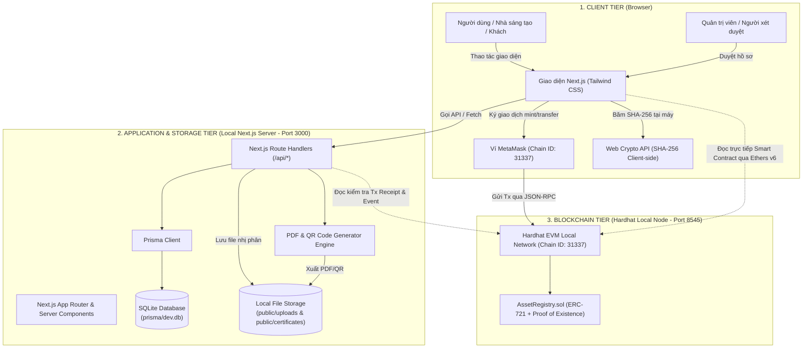
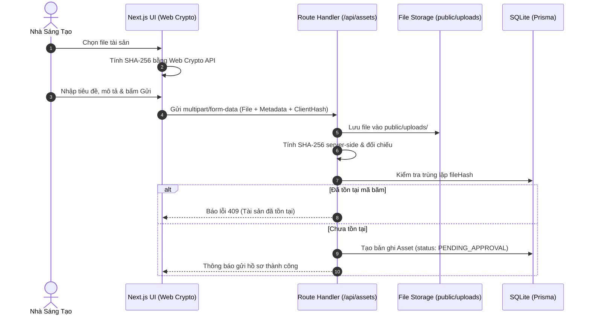
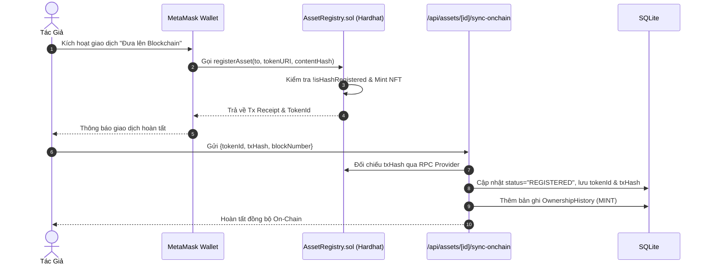

# Kiến Trúc Hệ Thống AssetChain (Local-First Fullstack)

**AssetChain** là nền tảng đăng ký, xét duyệt, phát hành chứng nhận và quản lý quyền sở hữu tài sản số trên nền tảng **Blockchain EVM** kết hợp kiến trúc **Web2 hiện đại tối giản (Next.js Fullstack + SQLite + Prisma)**.

Kiến trúc được tối ưu hóa đặc biệt cho nhóm 2 thành viên triển khai và vận hành **100% trên môi trường local**, loại bỏ sự cồng kềnh của Docker/PostgreSQL/NestJS nhưng vẫn đảm bảo tính toàn vẹn, bảo mật và chuẩn mực Web3.

---

## 1. Sơ Đồ Kiến Trúc Tổng Thể

---

## 2. Phân Định Dữ Liệu 3 Lớp (Data Segregation)

| Tiêu chí | Lưu trữ On-Chain (Smart Contract) | Lưu trữ Off-Chain (SQLite Database) | Lưu trữ File Local (`public/`) |
|---|---|---|---|
| **Công nghệ** | Solidity `^0.8.24` trên Hardhat EVM | SQLite file (`dev.db`) qua Prisma ORM | File System local của máy tính |
| **Dữ liệu lưu trữ** | - `tokenId` - `bytes32 contentHash` (SHA-256) - Địa chỉ ví tác giả (`creator`) - Địa chỉ ví chủ sở hữu (`owner`) - Mốc thời gian on-chain (`registeredAt`) - Cờ thu hồi `isRevoked` & lý do | - Thông tin tài khoản & mật khẩu băm - Tiêu đề, mô tả, thể loại tài sản - Dung lượng (`fileSize`), loại file (`mimeType`) - Trạng thái xét duyệt (`PENDING_APPROVAL`, `APPROVED`, ...) - Mã chứng nhận `certificateNumber` - Lịch sử thao tác & đồng bộ | - File tài sản nhị phân gốc (ảnh JPG, PNG, PDF thiết kế) - File chứng nhận điện tử định dạng PDF sinh tự động |
| **Đặc tính** | Bất biến, công khai, phi tập trung, không thể sửa đổi hay làm giả | Truy vấn nhanh, hỗ trợ tìm kiếm, lọc danh mục, phân trang, lưu dữ liệu nhạy cảm | Dung lượng lớn, phục vụ hiển thị trực tiếp trên trình duyệt |

---

## 3. Chi Tiết 6 Luồng Nghiệp Vụ Cốt Lõi

### Luồng 1: Người dùng đăng ký tài sản
1. Người dùng chọn file ảnh/tài liệu trên giao diện web.
2. Trình duyệt sử dụng **Web Crypto API** để tính mã băm `SHA-256` của file ngay tại máy client.
3. Người dùng điền thông tin (tiêu đề, mô tả, danh mục) và bấm "Gửi đăng ký".
4. Dữ liệu (file + metadata + clientHash) được gửi lên API `/api/assets`.
5. Backend:
   - Lưu file nhị phân vào thư mục `public/uploads/`.
   - Tính lại mã băm SHA-256 trên server để đối chiếu tính toàn vẹn với `clientHash`.
   - Kiểm tra trùng lặp `fileHash` trong SQLite (nếu đã có người đăng ký mã băm này -> cảnh báo ngay).
   - Tạo bản ghi trong SQLite với trạng thái ban đầu là `PENDING_APPROVAL`.

---

### Luồng 2: Xét duyệt tài sản (Admin Approval)
1. Quản trị viên truy cập Cổng quản trị `/admin/approvals`.
2. Hệ thống gọi API `/api/admin/assets?status=PENDING_APPROVAL` lấy danh sách hồ sơ chờ duyệt.
3. Quản trị viên kiểm tra nội dung file gốc, tính hợp lệ của thông tin.
4. Quản trị viên đưa ra quyết định:
   - **Từ chối (Reject):** Nhập lý do từ chối -> API cập nhật trạng thái `REJECTED` và lưu `rejectionReason` vào SQLite.
   - **Phê duyệt (Approve):** API cập nhật trạng thái `APPROVED`. Lúc này hệ thống cho phép bước tiếp theo (Mint on-chain & cấp chứng nhận).

---

### Luồng 3: Xác nhận quyền sở hữu trên Blockchain (Mint on-chain)
1. Sau khi hồ sơ được duyệt (`APPROVED`), tác giả (hoặc Admin tùy luồng) mở trang chi tiết tài sản và bấm "Đưa lên Blockchain".
2. Trình duyệt kích hoạt ví **MetaMask**, yêu cầu người dùng xác nhận giao dịch gọi hàm `registerAsset(to, uri, contentHash)` trên hợp đồng `AssetRegistry.sol`.
3. Mạng Hardhat EVM thực thi giao dịch, kiểm tra tính duy nhất của mã băm trên chuỗi, tăng `tokenId` và phát sự kiện `AssetRegistered`.
4. Sau khi MetaMask nhận được Transaction Receipt:
   - Client gửi `tokenId`, `txHash`, `blockNumber` về API `/api/assets/[id]/sync-onchain`.
   - Backend xác thực lại transaction receipt từ Hardhat RPC node.
   - Cập nhật trạng thái trong SQLite thành `REGISTERED`.
   - Tự động ghi nhận một bản ghi vào bảng `OwnershipHistory` (sự kiện: `MINT`).

---

### Luồng 4: Cấp và xác minh chứng nhận (E-Certificate)
1. **Cấp chứng nhận:**
   - Khi tài sản chuyển sang trạng thái `REGISTERED` (hoặc `APPROVED`), hệ thống tự động sinh số hiệu chứng nhận (Ví dụ: `CERT-2026-0001`).
   - Tạo mã QR Code trỏ đến URL xác minh công khai: `http://localhost:3000/verify?hash=<contentHash>`.
   - Render file chứng nhận điện tử định dạng PDF (hoặc SVG) chuẩn chỉnh, chứa: Tên tài sản, Tác giả, Thời điểm on-chain, Mã băm SHA-256, Transaction Hash, Token ID và Con dấu chứng thực.
   - Lưu thông tin vào bảng `Certificate` trong SQLite và lưu file PDF vào thư mục `public/certificates/`.
2. **Xác minh chứng nhận:**
   - **Cách 1 (Quét QR hoặc nhập Token ID):** Người dùng quét mã QR trên chứng nhận để truy cập thẳng vào trang xác minh, xem đầy đủ mốc thời gian và chữ ký on-chain.
   - **Cách 2 (Kéo - Thả file trực tiếp - 1-Click Verification):** Bất kỳ ai cũng có thể kéo file tài sản vào cổng `/verify`. Trình duyệt tự băm SHA-256 của file và gọi trực tiếp hàm `getAssetByHash()` trên Smart Contract cũng như tra cứu SQLite. Nếu trùng khớp -> Hiển thị "CHỨNG NHẬN HỢP LỆ VÀ NGUYÊN BẢN".

---

### Luồng 5: Cơ chế đồng bộ dữ liệu giữa SQLite và Blockchain

Để giữ kiến trúc đơn giản tối đa cho nhóm 2 người, hệ thống áp dụng **cơ chế đồng bộ chủ động theo sự kiện (Event-Driven Optimistic Sync with Verification)** thay vì chạy các worker service ngầm phức tạp:

1. **Điểm kích hoạt:** Giao dịch on-chain được khởi tạo từ client thông qua MetaMask.
2. **Xác nhận biên nhận (Receipt Verification):** Khi client nhận được kết quả từ MetaMask, client lập tức gửi `txHash` về API backend.
3. **Kiểm tra độc lập từ Backend:** API backend sử dụng `ethers.JsonRpcProvider` kết nối tới Hardhat RPC (`http://127.0.0.1:8545`) để đọc lại biên nhận giao dịch (`getTransactionReceipt(txHash)`):
   - Đảm bảo giao dịch thực sự thành công (`receipt.status === 1`).
   - Đọc logs sự kiện `AssetRegistered` để trích xuất đúng `tokenId` và `contentHash`.
4. **Cập nhật SQLite:** Sau khi đối chiếu chính xác, backend cập nhật trạng thái `REGISTERED` trong SQLite trong một transaction duy nhất.

---

### Luồng 6: Xử lý sự cố khi giao dịch Blockchain thất bại

Một tình huống thường gặp là người dùng gửi hồ sơ thành công vào Database nhưng giao dịch trên Blockchain bị lỗi (Ví dụ: người dùng hủy giao dịch trên MetaMask, hết gas, hoặc Hardhat node bị dừng):

- **Trạng thái an toàn trong Database:** Bản ghi trong SQLite vẫn giữ trạng thái `APPROVED` (chưa chuyển sang `REGISTERED`), các trường `tokenId`, `txHash` vẫn để giá trị `null`.
- **Nút "Thử lại" (Retry Mechanism):** Trên giao diện của tác giả, tài sản vẫn hiển thị nhãn "Đã duyệt - Sẵn sàng đưa lên chuỗi" kèm nút **"Thực hiện lại giao dịch"**. Người dùng có thể nhấn nút này bất cứ lúc nào để mở lại MetaMask mà không phải tạo lại hồ sơ từ đầu.
- **Tính nhất quán:** Smart Contract chỉ ghi nhận khi giao dịch hoàn tất. Vì vậy không bao giờ xảy ra tình trạng "on-chain có dữ liệu nhưng Database không có" hoặc ngược lại.
