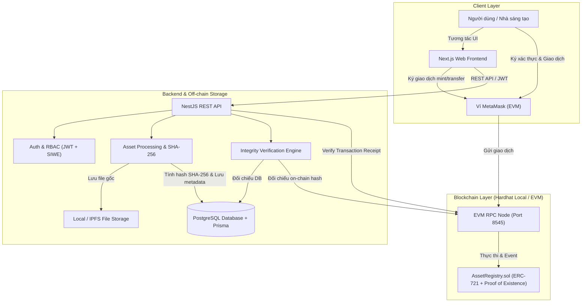

# Kiến Trúc Hệ Thống AssetChain

**AssetChain** là hệ thống đăng ký, xác minh và quản lý quyền sở hữu tài sản số ứng dụng công nghệ Blockchain (EVM) kết hợp kiến trúc Web2 phân lớp (Next.js + NestJS + PostgreSQL).

---

## 1. Nguyên Tắc Cốt Lõi & Giới Hạn Pháp Lý - Kỹ Thuật

> [!IMPORTANT]
> **Tuyên bố về giá trị pháp lý và kỹ thuật:**
> - **Blockchain đóng vai trò kỹ thuật:** Cung cấp bằng chứng tồn tại không thể chối bỏ (*Proof of Existence*) tại một thời điểm xác định ($t$) và lịch sử chuyển dịch nguồn gốc minh bạch (*Provenance*).
> - **Không tự động chứng minh quyền sở hữu pháp lý:** Blockchain không thể tự xác minh xem người tải lên có thực sự là tác giả gốc ngoài đời thực hay không (vấn đề "Garbage In, Garbage Out"). Hệ thống thiết lập quy trình kiểm duyệt tài khoản, ký số định danh và xử lý tranh chấp (*Dispute Resolution*) để hỗ trợ quản trị, không thay thế cơ quan nhà nước có thẩm quyền cấp văn bằng bảo hộ sở hữu trí tuệ.
> - **Không lưu dữ liệu nhạy cảm trên Blockchain:** Tuyệt đối **không** lưu mật khẩu, private key, thông tin định danh cá nhân (PII), hay file nhị phân dung lượng lớn on-chain. Blockchain chỉ lưu trữ: `tokenId`, mã băm nội dung `bytes32 contentHash` (SHA-256), địa chỉ ví người tạo, địa chỉ chủ sở hữu hiện tại, timestamp và URI dẫn đến metadata.

---

## 2. Phân Tách Trách Nhiệm (Separation of Concerns)

### 2.1. Phân định dữ liệu On-Chain vs. Off-Chain

| Đặc tính | Lưu trữ On-Chain (Smart Contract) | Lưu trữ Off-Chain (PostgreSQL & Storage) |
| :--- | :--- | :--- |
| **Dữ liệu lưu** | `tokenId`, `contentHash` (SHA-256), ví `creator`, ví `owner`, `tokenURI`, `registeredAt`, `isRevoked` | Email, passwordHash, tên, avatar, bio, file gốc, fileSize, MIME type, mô tả chi tiết, tags, lịch sử cấp phép, logs tranh chấp |
| **Mục đích** | Bằng chứng tồn tại bất biến, kiểm chứng tính toàn vẹn công khai, chuyển nhượng quyền sở hữu phi tập trung | Tối ưu tốc độ tìm kiếm, truy vấn phân trang, bảo vệ quyền riêng tư, lưu file dung lượng lớn |
| **Chi phí / Hiệu năng** | Tốn gas, dung lượng giới hạn | Tốc độ cao, chi phí thấp, linh hoạt mở rộng |

### 2.2. Cơ chế Xác thực: Web2 JWT vs. Xác minh Ví Web3
1. **Tài khoản Web2 (JWT):** Dùng để quản lý phiên làm việc, hồ sơ cá nhân, bảo mật thông tin nội bộ và phân quyền vai trò (User, Creator, Admin).
2. **Liên kết ví (Wallet Binding via Signature Challenge / SIWE):**
   - Người dùng đăng nhập hệ thống -> yêu cầu liên kết ví.
   - Backend phát hành một chuỗi ngẫu nhiên (`nonce`) kèm thông điệp chuẩn (EIP-4361 / `personal_sign`).
   - Người dùng ký thông điệp bằng MetaMask mà không tốn phí gas.
   - Backend khôi phục địa chỉ ví (`ethers.verifyMessage`) và liên kết địa chỉ ví đã xác minh vào tài khoản người dùng trong cơ sở dữ liệu.
   - **Mục tiêu:** Đảm bảo chỉ người thực sự nắm giữ khóa riêng tư của ví mới có thể liên kết và thực hiện các hành động đại diện cho địa chỉ ví đó.

---

## 3. Luồng Nghiệp Vụ Chính

### 3.1. Đăng ký tài sản số (Asset Registration Flow)
1. **Upload & Fingerprinting:**
   - Người dùng tải tệp tài sản số (hình ảnh, tài liệu, âm thanh...) lên giao diện.
   - Backend tính toán mã băm `SHA-256` nhị phân (`contentHash`).
   - Backend kiểm tra trùng lặp mã băm trong database và kiểm tra on-chain thông qua contract method `getAssetByHash(contentHash)`.
   - Nếu đã tồn tại, cảnh báo xung đột (tài sản đã từng được ghi nhận trước đó).
   - Nếu hợp lệ, lưu tệp vào vùng lưu trữ an toàn và tạo bản ghi metadata JSON (`tokenURI`).
2. **Ký giao dịch On-chain:**
   - Frontend nhận `contentHash` và `tokenURI` từ backend.
   - Frontend kích hoạt MetaMask để người dùng ký và gửi giao dịch `registerAsset(tokenURI, contentHash)` vào smart contract `AssetRegistry.sol`.
3. **Xác thực và Đồng bộ (Receipt Verification):**
   - Sau khi giao dịch được xác nhận (mined) trên blockchain, client gửi `txHash` về backend.
   - Backend độc lập kết nối đến EVM RPC Node, lấy Transaction Receipt, kiểm tra:
     - Trạng thái giao dịch (`status === 1`).
     - Địa chỉ hợp đồng gọi tới có đúng `AssetRegistry` hay không.
     - Phân tích event `AssetRegistered(tokenId, creator, contentHash)` từ log.
   - Cập nhật trạng thái tài sản trong cơ sở dữ liệu thành `REGISTERED` kèm `tokenId` và `blockNumber`.

### 3.2. Xác minh tính toàn vẹn tài sản (Integrity Verification Flow)
- Bất kỳ ai (kể cả Guest không cần đăng nhập) đều có thể:
  1. Tải lên tệp tài sản bất kỳ hoặc nhập chuỗi băm `SHA-256`.
  2. Hệ thống tính hash của tệp đó.
  3. Hệ thống đối chiếu song song:
     - **Database:** Tìm kiếm thông tin tác giả, metadata, trạng thái báo cáo tranh chấp.
     - **Blockchain:** Gọi trực tiếp hàm view `getAssetByHash(contentHash)` trên Smart Contract để lấy `tokenId`, `creator`, `registeredAt`.
  4. Trả về kết quả:
     - **Toàn vẹn & Hợp lệ:** Tệp khớp hoàn toàn với dữ liệu đã đăng ký trên chuỗi, hiển thị mốc thời gian đăng ký đầu tiên và chủ sở hữu hiện tại.
     - **Bị chỉnh sửa / Chưa đăng ký:** Tệp không khớp bất kỳ bản ghi nào trên chuỗi.
     - **Bị gắn cờ / Thu hồi:** Tài sản có tranh chấp hoặc đã bị thu hồi bởi quản trị viên.

---

## 4. Mô Hình Phân Quyền (RBAC)

- **GUEST (Khách vãng lai):**
  - Xem danh mục tài sản số công khai.
  - Sử dụng công cụ xác minh toàn vẹn tệp (Integrity Verifier).
  - Tra cứu lịch sử nguồn gốc (Provenance timeline).
- **USER / CREATOR:**
  - Toàn bộ quyền của Guest.
  - Đăng ký hồ sơ Creator, cập nhật thông tin giới thiệu.
  - Liên kết ví MetaMask.
  - Đăng ký tài sản số mới.
  - Chuyển quyền sở hữu (Transfer) tài sản đang sở hữu.
  - Thiết lập điều khoản cấp phép sử dụng (Licensing - Phase 2).
- **ADMIN:**
  - Xem danh sách người dùng, kích hoạt / khóa tài khoản.
  - Tiếp nhận và xử lý báo cáo tranh chấp bản quyền (Disputes).
  - Đánh dấu trạng thái tài sản vi phạm (`FLAGGED` / `REVOKED`) trên database và gọi hàm quản trị `revokeAsset` trên smart contract khi có phán quyết hợp lệ.
