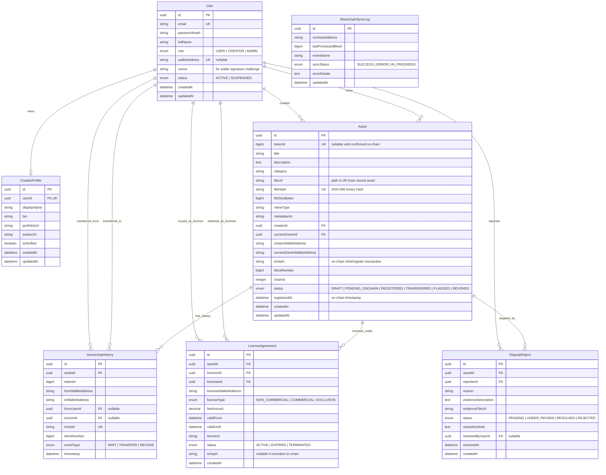

# Thiết Kế Cơ Sở Dữ Liệu (PostgreSQL & Prisma ERD)

Dưới đây là thiết kế chi tiết cơ sở dữ liệu cho hệ thống AssetChain, phục vụ việc lưu trữ off-chain, quản lý người dùng, metadata tài sản và đồng bộ trạng thái từ blockchain.

---

## 1. Sơ Đồ Thực Thể Quan Hệ (Mermaid ERD)

---

## 2. Từ Điển Dữ Liệu Chi Tiết

### 2.1. Bảng `User`
- Quản lý tài khoản Web2, vai trò và thông tin xác thực ví Web3.
- `nonce`: Chuỗi ngẫu nhiên sinh ra mỗi lần người dùng bắt đầu quy trình liên kết ví để chống tấn công phát lại (*Replay Attack*).
- `walletAddress`: Địa chỉ ví Ethereum (0x...) duy nhất sau khi đã ký xác thực qua chữ ký mật mã học.

### 2.2. Bảng `Asset`
- Lưu trữ toàn bộ metadata phong phú của tài sản số.
- `fileHash`: Giá trị băm SHA-256 chuẩn (chuỗi hex 64 ký tự, tương ứng `bytes32` trên smart contract). Đánh index duy nhất (`UNIQUE`) để ngăn chặn việc đăng ký trùng lặp file.
- `tokenId`: Mã định danh số nguyên trên Smart Contract ERC-721. Ban đầu là `null` khi mới upload, được cập nhật sau khi transaction receipt trên blockchain xác nhận thành công.
- `status`:
  - `DRAFT`: Đã upload file và tính toán hash, chờ người dùng ký giao dịch.
  - `PENDING_ONCHAIN`: Đã gửi giao dịch lên mempool, đang chờ khai thác block.
  - `REGISTERED`: Đã xác nhận on-chain thành công, hợp đồng thông minh đã lưu `contentHash`.
  - `TRANSFERRED`: Quyền sở hữu đã được chuyển giao cho ví khác.
  - `FLAGGED`: Đang bị báo cáo tranh chấp bản quyền, tạm thời cảnh báo người dùng.
  - `REVOKED`: Đã bị thu hồi do vi phạm bản quyền nghiêm trọng.

### 2.3. Bảng `OwnershipHistory`
- Nhật ký bất biến ghi nhận mọi sự kiện chuyển dịch quyền sở hữu (`MINT`, `TRANSFER`, `REVOKE`).
- Lưu trữ liên kết kép: vừa lưu địa chỉ ví on-chain (`fromWalletAddress`, `toWalletAddress`), vừa ánh xạ tới tài khoản người dùng tương ứng trong hệ thống (`fromUserId`, `toUserId`) nếu họ đã tạo tài khoản.

### 2.4. Bảng `LicenseAgreement` (Phase 2 - Chức năng Nâng cao)
- Quản lý quyền sử dụng có điều kiện: Thời hạn hiệu lực, loại giấy phép (Thương mại / Phi thương mại), mức phí và điều khoản chi tiết.
- Giúp người sở hữu tài sản có thể cấp quyền khai thác mà không làm mất đi quyền sở hữu gốc on-chain.

### 2.5. Bảng `DisputeReport` (Phase 2 - Quản trị Tranh chấp)
- Cơ chế hỗ trợ người dùng khiếu nại tài sản bị sao chép hoặc vi phạm bản quyền ngoài đời thực.
- Cung cấp giao diện cho Admin xem bằng chứng đối chiếu và đưa ra phán quyết xử lý minh bạch.

### 2.6. Bảng `BlockchainSyncLog`
- Ghi nhận trạng thái con trỏ đồng bộ khối (`blockNumber`) của background worker để tránh xử lý trùng sự kiện on-chain khi hệ thống khởi động lại.
