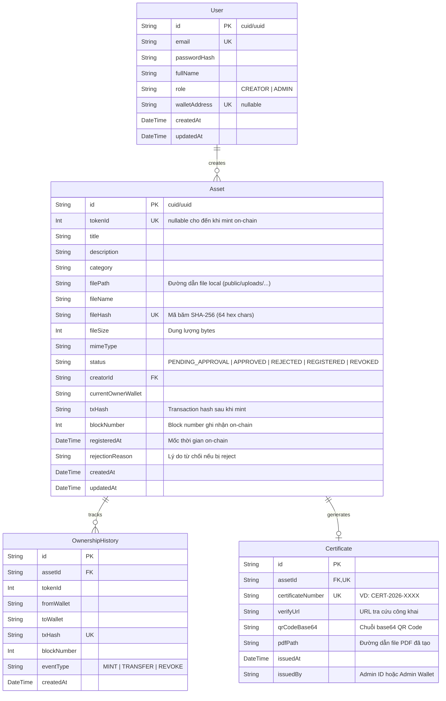

# Thiết Kế Cơ Sở Dữ Liệu (SQLite & Prisma ORM)

Hệ thống AssetChain sử dụng **SQLite** kết hợp cùng **Prisma ORM** để phục vụ lưu trữ dữ liệu Web2 off-chain. Giải pháp này giúp loại bỏ hoàn toàn sự phụ thuộc vào Docker hoặc PostgreSQL server cồng kềnh, cho phép 2 thành viên chạy độc lập trên máy local mà không lo xung đột cổng hay tài nguyên.

---

## 1. Sơ Đồ Thực Thể Quan Hệ (Mermaid ERD)



---

## 2. Chi Tiết Prisma Schema (`prisma/schema.prisma`)

```prisma
datasource db {
  provider = "sqlite"
  url      = env("DATABASE_URL")
}

generator client {
  provider = "prisma-client-js"
}

model User {
  id            String    @id @default(cuid())
  email         String    @unique
  passwordHash  String
  fullName      String
  role          String    @default("CREATOR") // "CREATOR" | "ADMIN"
  walletAddress String?   @unique
  createdAt     DateTime  @default(now())
  updatedAt     DateTime  @updatedAt

  assets        Asset[]

  @@map("users")
}

model Asset {
  id                 String             @id @default(cuid())
  tokenId            Int?               @unique
  title              String
  description        String
  category           String             @default("ART")
  filePath           String
  fileName           String
  fileHash           String             @unique // 64 ký tự hex SHA-256
  fileSize           Int
  mimeType           String
  status             String             @default("PENDING_APPROVAL") 
  // Trạng thái: PENDING_APPROVAL -> APPROVED (hoặc REJECTED) -> REGISTERED -> REVOKED
  
  creatorId          String
  creator            User               @relation(fields: [creatorId], references: [id])
  
  currentOwnerWallet String
  txHash             String?
  blockNumber        Int?
  registeredAt       DateTime?
  rejectionReason    String?

  createdAt          DateTime           @default(now())
  updatedAt          DateTime           @updatedAt

  history            OwnershipHistory[]
  certificate        Certificate?

  @@index([status])
  @@index([currentOwnerWallet])
  @@map("assets")
}

model OwnershipHistory {
  id           String   @id @default(cuid())
  assetId      String
  asset        Asset    @relation(fields: [assetId], references: [id], onDelete: Cascade)
  tokenId      Int
  fromWallet   String
  toWallet     String
  txHash       String   @unique
  blockNumber  Int
  eventType    String   // "MINT" | "TRANSFER" | "REVOKE"
  createdAt    DateTime @default(now())

  @@map("ownership_histories")
}

model Certificate {
  id                String   @id @default(cuid())
  assetId           String   @unique
  asset             Asset    @relation(fields: [assetId], references: [id], onDelete: Cascade)
  certificateNumber String   @unique
  verifyUrl         String
  qrCodeBase64      String?  // Dữ liệu base64 để hiển thị nhanh
  pdfPath           String?  // Đường dẫn file PDF lưu trữ cục bộ
  issuedAt          DateTime @default(now())
  issuedBy          String   // Địa chỉ ví hoặc ID của Admin cấp duyệt

  @@map("certificates")
}
```

---

## 3. Phân Định Lưu Trữ 3 Lớp

| Thành phần | Dữ liệu lưu trữ | Mục đích |
|---|---|---|
| **SQLite (Prisma)** | Users, Mật khẩu băm, Thông tin chi tiết tài sản (tiêu đề, mô tả, danh mục, file size), Trạng thái duyệt (`status`), Lý do từ chối, Đường dẫn file cục bộ, Metadata chứng nhận. | Truy vấn nhanh, phục vụ hiển thị Dashboard, quản trị Admin, phân trang và tìm kiếm. |
| **Blockchain (EVM Contract)** | `tokenId`, `bytes32 contentHash` (SHA-256), `creator` address, `owner` address, `registeredAt` timestamp, `isRevoked` flag, `tokenURI`. | Bằng chứng sở hữu bất biến (*Proof of Existence* & *Provenance*), không thể sửa đổi, đối chiếu xác minh độc lập không cần backend. |
| **Local File Storage** | File ảnh/tài sản gốc tải lên (`public/uploads/...`), File E-Certificate PDF tạo ra (`public/certificates/...`). | Lưu trữ vật lý tài nguyên nhị phân dung lượng lớn để phục vụ hiển thị trên trình duyệt. |
